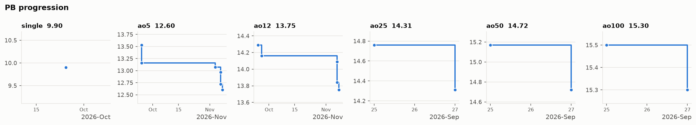

# 3x3 PBs

Personal-best averages, with the full solve list and stats behind each one. New here? [What's in this repo →](REPO_GUIDE.md)

## Current PBs

| Event | PB | Date | Stats |
|---|---|---|---|
| **single** | **9.75** | 2026-11-08 | [details](stats/single/single_2026-11-08.md) |
| **ao5** | **12.03** | 2026-11-12 (#2) | [details](stats/ao5/ao5_2026-11-12_2.md) |
| **ao12** | **13.24** | 2026-11-12 | [details](stats/ao12/ao12_2026-11-12.md) |
| **ao25** | **13.85** | 2026-11-11 | [details](stats/ao25/ao25_2026-11-11.md) |
| **ao50** | **14.29** | 2026-11-11 | [details](stats/ao50/ao50_2026-11-11.md) |
| **ao100** | **14.54** | 2026-11-11 | [details](stats/ao100/ao100_2026-11-11.md) |

**[Highlights →](highlights/README.md)** (9 singles, 7 ao5s, 1 ao12)

## PB history

Newest first. Each new PB pushes the older ones down.

### single

| Date | Time | Improvement | σ | σ / mean | Stats |
|---|---|---|---|---|---|
| 2026-11-08 | **9.75** | −0.15 | — | — | [details](stats/single/single_2026-11-08.md) |
| 2026-09-25 | 9.90 | first recorded | — | — | [details](stats/single/single_2026-09-25.md) |

### ao5

| Date | Time | Improvement | σ | σ / mean | Stats |
|---|---|---|---|---|---|
| 2026-11-12 (#2) | **12.03** | −0.45 | 1.48 | 11.9% | [details](stats/ao5/ao5_2026-11-12_2.md) |
| 2026-11-12 | 12.48 | −0.11 | 1.58 | 12.5% | [details](stats/ao5/ao5_2026-11-12.md) |
| 2026-11-11 | 12.59 | −0.01 | 1.22 | 9.6% | [details](stats/ao5/ao5_2026-11-11.md) |
| 2026-11-08 | 12.60 | −0.12 | 0.84 | 6.6% | [details](stats/ao5/ao5_2026-11-08.md) |
| 2026-11-07 (#2) | 12.72 | −0.25 | 1.64 | 12.7% | [details](stats/ao5/ao5_2026-11-07_2.md) |
| 2026-11-07 | 12.97 | −0.10 | 1.61 | 12.4% | [details](stats/ao5/ao5_2026-11-07.md) |
| 2026-11-04 | 13.07 | −0.09 | 1.71 | 12.8% | [details](stats/ao5/ao5_2026-11-04.md) |
| 2026-09-25 (#2) | 13.16 | −0.37 | 2.19 | 15.9% | [details](stats/ao5/ao5_2026-09-25_2.md) |
| 2026-09-25 | 13.53 | first recorded | 1.04 | 7.7% | [details](stats/ao5/ao5_2026-09-25.md) |

### ao12

| Date | Time | Improvement | σ | σ / mean | Stats |
|---|---|---|---|---|---|
| 2026-11-12 | **13.24** | −0.29 | 1.48 | 11.2% | [details](stats/ao12/ao12_2026-11-12.md) |
| 2026-11-11 | 13.53 | −0.22 | 1.47 | 10.7% | [details](stats/ao12/ao12_2026-11-11.md) |
| 2026-11-08 | 13.75 | −0.09 | 2.27 | 16.5% | [details](stats/ao12/ao12_2026-11-08.md) |
| 2026-11-07 (#2) | 13.84 | −0.25 | 1.40 | 10.1% | [details](stats/ao12/ao12_2026-11-07_2.md) |
| 2026-11-07 | 14.09 | −0.07 | 1.55 | 11.0% | [details](stats/ao12/ao12_2026-11-07.md) |
| 2026-09-27 | 14.16 | −0.13 | 1.66 | 11.8% | [details](stats/ao12/ao12_2026-09-27.md) |
| 2026-09-25 | 14.29 | first recorded | 2.60 | 17.6% | [details](stats/ao12/ao12_2026-09-25.md) |

### ao25

| Date | Time | Improvement | σ | σ / mean | Stats |
|---|---|---|---|---|---|
| 2026-11-11 | **13.85** | −0.46 | 1.88 | 13.6% | [details](stats/ao25/ao25_2026-11-11.md) |
| 2026-09-27 | 14.31 | −0.45 | 1.88 | 13.0% | [details](stats/ao25/ao25_2026-09-27.md) |
| 2026-09-25 | 14.76 | first recorded | 2.84 | 18.8% | [details](stats/ao25/ao25_2026-09-25.md) |

### ao50

| Date | Time | Improvement | σ | σ / mean | Stats |
|---|---|---|---|---|---|
| 2026-11-11 | **14.29** | −0.43 | 2.13 | 14.8% | [details](stats/ao50/ao50_2026-11-11.md) |
| 2026-09-27 | 14.72 | −0.45 | 2.49 | 16.6% | [details](stats/ao50/ao50_2026-09-27.md) |
| 2026-09-25 | 15.17 | first recorded | 2.47 | 16.1% | [details](stats/ao50/ao50_2026-09-25.md) |

### ao100

| Date | Time | Improvement | σ | σ / mean | Stats |
|---|---|---|---|---|---|
| 2026-11-11 | **14.54** | −0.76 | 2.08 | 14.2% | [details](stats/ao100/ao100_2026-11-11.md) |
| 2026-09-27 | 15.30 | −0.20 | 2.39 | 15.4% | [details](stats/ao100/ao100_2026-09-27.md) |
| 2026-09-25 | 15.50 | first recorded | 2.47 | 15.8% | [details](stats/ao100/ao100_2026-09-25.md) |
