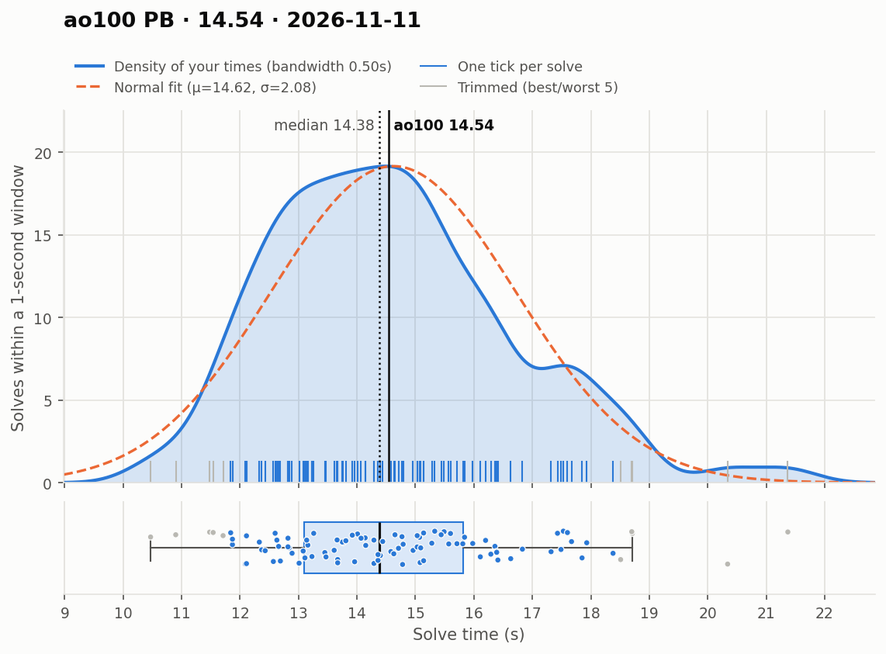
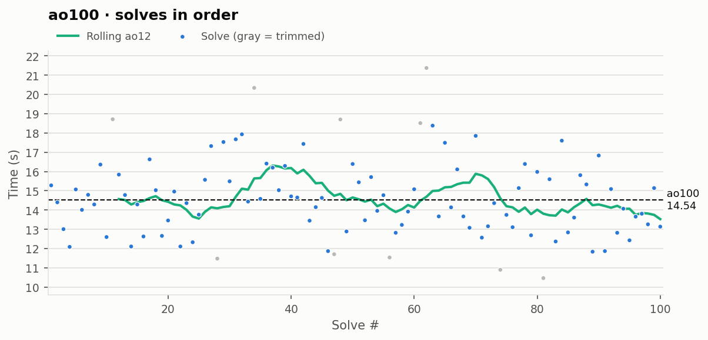

# ao100 PB — 14.54

**Date:** 2026-11-11  
**Previous PB:** 15.30 (2026-09-27) · improved by **0.76s**  
[← all records](../../README.md)

## Stats

| | |
|---|---|
| **ao100 (official, trimmed)** | **14.54** |
| Solves | 100 (trimmed 5 from each end) |
| Mean (all solves) | 14.62 |
| Median | 14.38 |
| Std dev (σ, all solves) | 2.08 |
| Std dev (σ, counted solves only) | 1.65 |
| **Consistency: σ / mean** | **14.2%** |
| Consistency, outlier-proof: IQR / median | 18.9% |
| Min / Best | 10.47 |
| Q1 (25th pct) | 13.10 |
| Q3 (75th pct) | 15.82 |
| Max / Worst | 21.37 |
| IQR (Q3 − Q1) | 2.72 |
| Range | 10.90 |
| Skewness | +0.65 |
| Shapiro–Wilk p (normality) | 0.036 |

**Sub-X counts:** sub-11: 2 · sub-12: 8 · sub-13: 23 · sub-14: 42 · sub-15: 60 · sub-16: 77

Skewness > 0 means a longer tail of slow solves (typical for cubing). Shapiro–Wilk p < 0.05 means the times are unlikely to be normally distributed.

## Distribution

## Solves in order

## Solves

| # | Time | Scramble |
|---|---|---|
| 1 | **15.28** | `F' D L2 R2 B' D2 F R2 B' D2 F R2 U' F' D2 B2 L' R D' L2` |
| 2 | **14.40** | `L' U2 F2 D2 U2 L F2 L F2 D2 R' B' U B2 U L B L D' U L` |
| 3 | **13.01** | `D2 B2 R2 D2 F2 D F2 L2 B2 F2 D2 U' L B' D2 R D' B F' L U` |
| 4 | **12.09** | `D R' L2 D2 F L2 D2 R2 F2 L2 B F' L U2 R2 B' U L F'` |
| 5 | **15.07** | `F D' R2 D' L2 U2 L2 U' L2 U2 B2 L' B D2 U F2 D' B' F2` |
| 6 | **14.01** | `L2 D2 B2 L2 U2 B2 R F2 U2 B2 U2 R F' D U B' U L' R' B'` |
| 7 | **14.79** | `L2 U2 B' D2 F' R2 D' L' B' F2 U2 R D2 B2 U2 R U2 R' D2 F2` |
| 8 | **14.29** | `F R' U' B2 R2 D' U' B2 U' R2 F2 R2 U' B' D2 L' B U R' B' L2` |
| 9 | **16.36** | `D' L2 B2 R2 F' L2 B' D2 U2 B' F' U2 F' R' D' R2 B' L' F D B2` |
| 10 | **12.60** | `F2 R D2 B2 L2 D2 F' U2 R2 U2 L2 R2 B2 L F2 U' B L U L2` |
| 11 | (18.71) | `B2 R B2 D2 B2 L2 D2 F2 L2 R' U2 B2 U R2 F L U2 L2 F2 U'` |
| 12 | **15.84** | `B2 D R2 D R2 U' R2 U2 R2 F2 R F' D' F U F' R' B F R` |
| 13 | **14.78** | `L2 U2 B L2 F L2 R2 B R2 B L2 F' D U2 R U F D' U' F2 D'` |
| 14 | **12.11** | `F2 D2 R2 F2 D2 L2 U' L2 U' B2 R' B D' L2 B2 L U' F' U B'` |
| 15 | **14.29** | `D B2 D' F2 D' B2 D2 F2 R2 D L D2 F' U' F R' B2 L' D F2` |
| 16 | **12.63** | `B2 U F D2 U2 L2 F R2 F' R2 D2 F' U2 B R U B' L2 R D` |
| 17 | **16.63** | `R' U2 L U2 F2 U2 L2 F2 U2 R D2 R U F' D U' B2 D' B' L2 F'` |
| 18 | **15.03** | `R2 F D2 R2 D2 L' B2 D2 R' B2 R U2 D F' U F' L2 D' L` |
| 19 | **12.66** | `L' B2 L F2 L' F2 R' F2 D2 B2 L D2 F D B U L2 D2 F L F` |
| 20 | **13.46** | `B2 D L' B2 F2 D2 R D2 L2 F2 L' B2 U2 F' D' R' B2 U' F D'` |
| 21 | **14.96** | `L2 F' R' U B' D' F R L' D2 L2 U2 B D2 F R2 L2 U2 F'` |
| 22 | **12.11** | `B' D2 B2 L2 D2 F' U2 F L2 F2 D' U' F L' D B' R2 D R` |
| 23 | **14.36** | `U R2 F2 U2 R2 F2 R' U2 R' B2 L F2 R' D' B D' F' U2 R' D` |
| 24 | **12.33** | `D F' D' F L2 B' L2 D2 R2 B' D2 B F2 L B' F2 R' D' F D2` |
| 25 | **13.76** | `F L' B2 D2 F2 D2 B' L2 D2 F2 U2 B D' L R2 U' B2 F` |
| 26 | **15.57** | `R B U' L2 F' R' U2 D' F' U2 D2 R D2 R2 U2 F2 R' U2 F2 L U2` |
| 27 | **17.32** | `F' R' F R2 L U B' F2 R2 D' B2 D F2 R2 D R2 U F2 L' U` |
| 28 | (11.48) | `R D' R' D' R U2 B' D2 L2 D2 L2 D F2 D' B2 L2 U' L2 U' F' D'` |
| 29 | **17.53** | `B2 R U' D B L B2 D R' D2 R U2 R' F2 U2 L U2 L2 F2 R'` |
| 30 | **15.49** | `F' B2 D2 B2 D2 U L2 D' B2 D L2 F D' U2 F' L R' F' D' U'` |
| 31 | **17.67** | `D2 L B U' F' R B R' D2 R2 B2 R' U2 L F2 U2 D2 L' F2 U' B2` |
| 32 | **17.93** | `F' L2 F2 D' R2 B2 U2 F2 R2 D2 L2 U' L B F U' L2 R D2 L'` |
| 33 | **14.44** | `B2 D L2 R2 U R2 B2 R2 D L2 B2 U' F R' U2 F D' R' D2 U2 R2` |
| 34 | (20.34) | `D' B' U' F U2 L2 B2 U2 L2 U2 F L2 R2 F2 R F' R2 D' U B' L'` |
| 35 | **14.58** | `D R' B L U' B2 U' B R2 F L2 B' U2 F U2 L2 B' L2 B2 L'` |
| 36 | **16.41** | `U' L2 U B2 U' F2 U L2 U2 L' U' L F' R U2 B2 F' U R'` |
| 37 | **16.20** | `F R' D' B' L B2 D' U2 B D2 F' U2 F2 U2 F D R` |
| 38 | **15.03** | `R B2 D F R' L2 B L2 B R2 F2 U' F2 D2 F2 D F2 U B2 U'` |
| 39 | **16.29** | `B2 L2 F' L' B L U2 L D' R2 D R2 F2 R2 F2 U B2 L2 D'` |
| 40 | **14.71** | `D2 B U2 L2 U' B2 U' F2 D B2 D R2 U' F2 B' L' D' F2 U2 L2 B` |
| 41 | **14.65** | `R2 D' B R2 B' D2 F' L2 F2 R2 D2 L2 U2 L' F' R' B D2 R2 U'` |
| 42 | **17.43** | `U L' D2 B U' B2 U L R2 B' D2 R2 L2 F' B' L2 B' U2 L2` |
| 43 | **13.45** | `F R F U' F2 B2 L' F U D R2 B2 R2 D2 R2 U B2 D L` |
| 44 | **14.15** | `R2 D U2 B2 L2 D' B2 L2 D2 R2 U' L F R F' R D' F' L2 U R'` |
| 45 | **14.63** | `D2 F2 R2 U2 L' R2 F2 R' U2 B2 D2 F' D' R2 U2 R B' U B2` |
| 46 | **11.87** | `D' R' B2 L D2 U2 F2 L D2 F2 R' D2 U R F R' U' R B' U'` |
| 47 | (11.71) | `D2 R2 U F2 L2 U2 R2 U' R2 U2 F' U2 R' U B2 F' U R' F2 R2` |
| 48 | (18.70) | `B2 R' D2 L2 B2 L D2 B2 L U2 R U B U L' B' U R' B L'` |
| 49 | **12.89** | `L' U2 B F2 R2 D2 R2 D2 F D2 R2 F R' F2 L U' L2 F' L2 B2` |
| 50 | **16.39** | `B L' U' R2 B2 L2 D2 F2 R2 U' F2 U' B2 D2 B R U2 B2 D F L` |
| 51 | **15.44** | `R2 B L2 B' L2 B2 L2 B' L2 F U' L' D' U F' L' R2 D2 U B2` |
| 52 | **13.47** | `L2 D2 B2 D' F2 R2 D' R2 F2 D' R2 B2 F R' F2 R' D R' D B' L` |
| 53 | **15.71** | `D B U' L D' F L' U D2 B2 L' D2 L' B2 R2 L' D2 F2 D2 L` |
| 54 | **13.96** | `B' L' U2 L2 U' R2 B2 U R2 D2 L2 B2 D' B2 R' U F D2 F D` |
| 55 | **14.77** | `L B2 U' L2 D F U B R' D2 R D2 L2 B2 U2 R B2 L' B'` |
| 56 | (11.54) | `F2 R2 D U B2 R2 U2 R2 D L' F2 D' R F L' B U2 L2 F` |
| 57 | **12.82** | `R D U2 B R2 B L2 D2 R2 F' D2 F U L U' L2 F2 L2 U2` |
| 58 | **13.23** | `L2 D2 B2 U R2 F2 U2 B2 R2 U2 B L' R' B D' R2 F' D' B L' R2` |
| 59 | **13.92** | `B2 U' F2 D R2 F2 U' R2 D' R2 B2 D2 R B2 R D2 U B U' R` |
| 60 | **15.08** | `B' L' D L2 D L U' F' U2 R2 U2 L' F2 B2 L2 U2 R' U2 B'` |
| 61 | (18.51) | `F L2 D2 R F' D' B U2 R' B2 L F2 B2 L' F2 D2 R2 U2 F` |
| 62 | (21.37) | `F2 L' R2 B2 U2 F2 U2 L' F2 L2 U2 D' B L' R U2 L' F U F'` |
| 63 | **18.38** | `L2 F2 R B2 L' B2 F2 D2 F2 R F2 R' D' L2 B F U' R2 F' L' D'` |
| 64 | **13.67** | `D R B U2 R U2 B2 U2 F2 U2 R' B2 L R2 F' R2 D U' L D R'` |
| 65 | **17.49** | `F U2 R2 D B' U2 B' L' F2 U L2 D2 R2 L2 U F2 U B2 D L2 R'` |
| 66 | **14.14** | `U' F2 U F2 R2 B2 R2 D B2 U' B D2 R' D L D U R' B2 U` |
| 67 | **16.11** | `R2 U R2 L' U2 D L2 U F' R F2 L' U2 F2 U2 R U2 R' B2 R2 B2` |
| 68 | **13.67** | `F B' R' L D L B' D L2 F' U2 L2 F2 R2 L2 U' R2 D B2 L2 D` |
| 69 | **13.08** | `F' L2 U2 B R2 U2 L2 U2 B' F2 D2 F2 R' D R2 F' D2 U2 L R2` |
| 70 | **17.85** | `U' B2 R2 B2 D2 L2 B' R D L R F L' D' B2 F` |
| 71 | **12.57** | `F' U2 B2 R' F2 R U2 R B2 U2 L' B2 R U' B' D' F L' F'` |
| 72 | **13.16** | `B' U2 F2 D2 L2 R' B2 U2 R2 D2 R' U2 D L' R' U L F' D2 L` |
| 73 | **14.36** | `D' F2 L2 R2 F2 D' B2 R2 B2 U' R D' L' B2 D B F2 U` |
| 74 | (10.90) | `F' D2 B L2 B R2 F' L2 F L2 U2 L' B2 D R' U2 L' B D R2 U2` |
| 75 | **13.75** | `F R B2 U' F2 L U' D F2 U2 R F2 U2 D2 R' D2 L' B` |
| 76 | **13.11** | `L2 F L U' F' L B' D' L2 U2 F' R2 U2 L2 D2 B' L2 B2 R2` |
| 77 | **15.14** | `R' F U2 F L2 F' L2 F R2 F L2 U2 L U L R' F D' B R2 D'` |
| 78 | **16.39** | `B2 R' B L2 F2 R2 U2 L2 D2 B' R2 B L2 D' B D' L2 B' R B` |
| 79 | **12.69** | `D2 U2 R B2 L2 R2 U2 B2 F2 R2 F' U R B' D2 L' D L' D` |
| 80 | **15.98** | `D' L F D2 B' D2 L2 F L2 D2 F2 R2 F' D2 U' R' F D2 R' D2 L` |
| 81 | (10.47) | `B2 D B2 U R2 U' L2 D F2 U' L2 R' B L R B2 D L2 B U'` |
| 82 | **15.60** | `R2 L' D' B' U F R F2 B2 R2 F2 B2 U2 L2 U' F2 D' R2 D' B' U'` |
| 83 | **12.37** | `U D F' D R' F2 L F2 U2 F2 L2 F D2 R2 U2 F2 R2 L2 F D B2` |
| 84 | **17.60** | `U2 F2 U' F' D L' B D F L D2 R2 B2 U2 F2 R' B2 R' L' F2 B2` |
| 85 | **12.84** | `D F2 L2 D F2 R2 B2 U' F2 D2 R' F' L D R' D2 B L' D2 B` |
| 86 | **13.61** | `F U' L F2 R2 B2 L' U' F' U2 B2 R2 D F2 R2 U B2 L2 B2` |
| 87 | **15.81** | `R2 D' B R L' B' D2 L' D R2 D2 L' B2 R D2 R2 F2 R B2 U2` |
| 88 | **15.33** | `L' B2 R2 B2 R2 D' F2 L2 U' R2 D U' R' B' U B2 D' B U` |
| 89 | **11.84** | `B2 U' D2 F' L2 F' D2 L2 B' R2 F L2 F2 L' U2 L' D' B' L D L'` |
| 90 | **16.83** | `B L B' F2 L2 F D2 F U2 L2 D2 L' B R2 U' R2 D' F L2` |
| 91 | **11.87** | `F D2 B' F2 R2 U2 F2 R2 D2 F U2 D R' F L R U' R B' U' R2` |
| 92 | **15.09** | `R2 U' D2 L2 F L2 B U2 L2 B R2 U2 F' U L' R' B' U B D` |
| 93 | **12.82** | `L2 F U2 F R2 U2 B U2 B2 D2 F2 R' D' L R2 D2 U' F' L' U2 F2` |
| 94 | **14.07** | `R U L' F D' F2 B2 U' L R2 U L2 F2 U' R2 L2 U R2 L2 D'` |
| 95 | **12.43** | `D L2 U B2 R2 D2 L2 D F2 U' R2 L F' D B2 L' B2 R F2 L2` |
| 96 | **13.66** | `U2 B D F U2 B U' B' R L F2 D2 L B2 L2 D2 R' F2 L2` |
| 97 | **13.81** | `U2 B2 U D' R F R2 B' F2 R2 B2 U2 L' D2 R D2 B2 D2 F` |
| 98 | **13.26** | `D2 R2 L B' U F' U' L R2 U2 R2 D R2 F2 D' F2 U2 B2 L2 U2 L` |
| 99 | **15.14** | `L2 U L2 R2 B2 U L2 D2 L2 U R U' F' L R2 D R' B D' L2 R'` |
| 100 | **13.14** | `B2 L2 U2 B2 D' U B2 R2 U2 R2 F D2 U' F' D U2 F' L R' B` |

Bold = counted, (parentheses) = trimmed. `+` = includes a +2 penalty.
