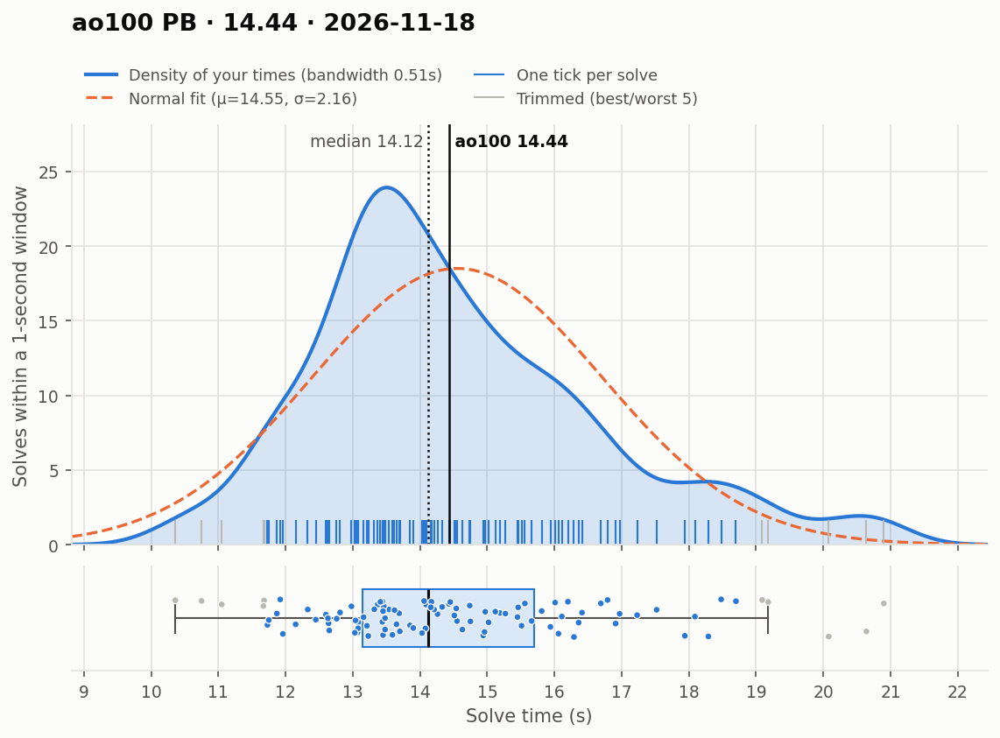
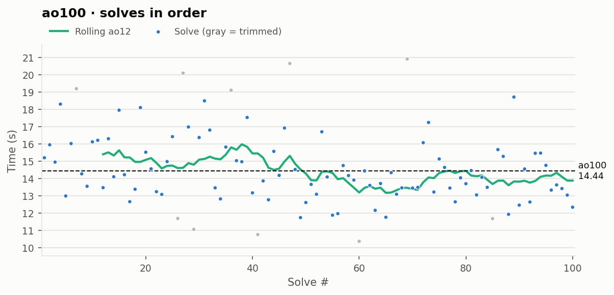

# ao100 PB — 14.44

**Date:** 2026-11-18  
**Previous PB:** 14.54 (2026-11-11) · improved by **0.10s**  
[← all records](../../README.md)

## Stats

| | |
|---|---|
| **ao100 (official, trimmed)** | **14.44** |
| Solves | 100 (trimmed 5 from each end) |
| Mean (all solves) | 14.55 |
| Median | 14.12 |
| Std dev (σ, all solves) | 2.16 |
| Std dev (σ, counted solves only) | 1.67 |
| **Consistency: σ / mean** | **14.8%** |
| Consistency, outlier-proof: IQR / median | 18.1% |
| Min / Best | 10.36 |
| Q1 (25th pct) | 13.14 |
| Q3 (75th pct) | 15.70 |
| Max / Worst | 20.90 |
| IQR (Q3 − Q1) | 2.56 |
| Range | 10.54 |
| Skewness | +0.83 |
| Shapiro–Wilk p (normality) | 0.001 |

**Sub-X counts:** sub-11: 2 · sub-12: 10 · sub-13: 20 · sub-14: 46 · sub-15: 66 · sub-16: 77

Skewness > 0 means a longer tail of slow solves (typical for cubing). Shapiro–Wilk p < 0.05 means the times are unlikely to be normally distributed.

## Distribution

## Solves in order

## Solves

| # | Time | Scramble |
|---|---|---|
| 1 | **15.19** | `F L2 D2 L' U2 L' B2 R U2 B2 U2 R2 B' D R' D2 R2 F L D2` |
| 2 | **15.94** | `F B R2 D R' D' R B2 L F U2 L2 B D2 B2 U2 L2 B` |
| 3 | **14.94** | `F D2 F2 R2 B' L2 U2 L2 U2 F' U2 B U F' L B2 R2 F' U' B F2` |
| 4 | **18.29** | `L2 F2 L2 D F2 L2 D' L2 U2 L2 F2 B' D' R F U R' F' U2 B F2` |
| 5 | **12.98** | `R2 F' D2 B2 U2 R2 B' D2 L2 B' D L' D2 R U2 L2 F R2 U B` |
| 6 | **16.01** | `B' R B2 U' L2 F2 U2 L2 F2 U2 F2 U' B' L2 F L B U F' U` |
| 7 | (19.18) | `R' D L2 U' F2 D' F2 D R2 U' R2 U F U' R B' F2 R2 F' U' F2` |
| 8 | **14.26** | `F2 D R D2 R' B L' F2 D R' L2 F2 R2 B' L2 U2 B U2 R2 F D2` |
| 9 | **13.54** | `U2 D2 B2 R F' U R U2 F2 U L2 F2 D L2 U' R2 U2 F2 R2 L U` |
| 10 | **16.11** | `D2 F2 L2 U2 R2 F2 R2 D B2 F2 R2 F R F2 R' U2 F' D2 U' B2` |
| 11 | **16.20** | `B L' B2 D F R2 D' F' B' L' D2 R' L U2 B2 R' F2 R` |
| 12 | **13.46** | `U2 F' L2 F2 R2 B R2 B' U2 B2 U' B L' R2 D F2 L B2 R'` |
| 13 | **16.29** | `F2 U' F2 D B2 L B2 U R2 B U2 D2 F' U2 B U2 L2 D2 F' R` |
| 14 | **14.09** | `U2 B' R' L2 B R' U2 R B U F2 D R2 F2 U2 F2 U'` |
| 15 | **17.94** | `R B L' F2 L D2 U2 L' B2 U2 R U2 L B2 U' R D L' D' U' B'` |
| 16 | **14.21** | `L R2 F2 U' R2 U2 L2 R2 D' B2 D U2 L2 R B' D2 B2 R' D2 U' R` |
| 17 | **12.65** | `L B D' F2 B' R' B D' R' F2 B2 U2 B2 L2 U2 R U2 L F2 B'` |
| 18 | **13.37** | `F L2 B2 U R2 U L2 U R2 U' B2 R2 D2 F' U2 L2 U' B' F L U2` |
| 19 | **18.09** | `F U2 L' D' B U' B' R' U' R2 U2 F R2 U2 B D2 F B2 D2 L2 D2` |
| 20 | **15.51** | `L2 D' B2 D F2 U2 L2 D B2 F2 U B2 F' L' B2 D B2 R' U' F' R'` |
| 21 | **14.55** | `F2 U2 B2 D F2 D L2 F2 L2 R2 D F U2 R B2 L2 F' L' U2 L2 D` |
| 22 | **13.23** | `B U L' U D F R2 B' L2 U L2 D2 R2 D' F2 D' B2 D2 B2 R2` |
| 23 | **13.07** | `L' F2 R2 B D2 L2 F' U2 B2 R2 F R2 F U F' D2 L U2 F2 L2 B2` |
| 24 | **14.97** | `U' R B U' R2 U' F2 U R2 D R2 B2 R2 U' F' R2 B' U2 L D2 L'` |
| 25 | **16.41** | `L D R2 D2 B2 F2 U' F2 D' U2 B2 U L' U R B' D U R' U'` |
| 26 | (11.68) | `B2 D' F2 R2 D L2 R2 F2 D' U' F2 L D2 U' B' R' F U2 L2 D2 L` |
| 27 | (20.08) | `U R2 F D2 R D2 R2 B2 U2 F2 R B2 F2 R F' L D' F' D2 B2 L'` |
| 28 | **16.97** | `B' R' L U D L' U' B D2 R' D2 F2 L2 F2 L' F2 B2 L2 D2 L B'` |
| 29 | (11.05) | `F' D F' D2 B R2 B' D2 F' U2 L2 F D' U' R' F' R2 D2 B` |
| 30 | **16.36** | `F' U' B2 F2 U' R2 D2 U' R2 B2 U L2 R D' B' R F D L2 R'` |
| 31 | **18.48** | `F U' B' D R2 L2 F' R U F' B' U2 F' R2 F' L2 B' D2 F'` |
| 32 | **16.79** | `R U2 L2 D2 U2 R' D2 F2 R2 F2 R F2 B U' R' U F L U2 F' L2` |
| 33 | **13.45** | `L2 F U' F2 U' F2 U R2 U R2 U L2 U F' R' B L D2 B' L` |
| 34 | **12.81** | `F L F' B U2 L' D2 R' B2 D R2 U F2 B2 L2 U2 F2 U' F2 D2 L'` |
| 35 | **15.81** | `D2 F U2 R2 D2 F L2 B2 F L B2 D' L2 F' L R' F U' L` |
| 36 | (19.09) | `U2 B2 R F2 D2 L2 B2 U2 R' D2 F2 R' F D U' B2 R' B' R' F' D'` |
| 37 | **15.02** | `B2 U L2 R2 U R2 F2 D' F2 D2 F2 U2 R' D' B' L' B2 D B R' D'` |
| 38 | **14.96** | `U' F' L' F2 L' U2 F2 D2 R D2 F2 R' B2 U' B2 D2 B L F' D2` |
| 39 | **17.52** | `R D' B2 L2 B2 L2 U B2 D' B2 L2 D U2 F' U' R D' F U' L2 D2` |
| 40 | **13.16** | `F R2 F' D2 U2 R2 D2 F L2 D U F R' U' B D' L' D2 B` |
| 41 | (10.75) | `R D2 F D2 U2 F R2 B L2 F' D2 R2 F' U F D2 B' F2 R' B R'` |
| 42 | **13.85** | `D' L2 D2 B2 U' F2 U L2 D' R D2 L2 U F L B' F L' R'` |
| 43 | **12.76** | `L2 U2 F2 U' R2 B2 F2 R2 B R' D2 L' B' D' B R' B` |
| 44 | **15.56** | `D' F2 U L D' L U2 R' F' U2 L2 B2 U2 R2 F D2 F D2 F' U2 R` |
| 45 | **14.17** | `R' F D' R2 B' R2 B R' U' F U2 R2 F2 D2 F L2 B' U2 B` |
| 46 | **16.91** | `L B2 U2 B2 R2 U' L2 D2 U' R2 B2 R2 B' R' F' D2 R' U' L' D` |
| 47 | (20.64) | `L' R2 B2 F' L2 F2 D2 F U2 B U2 B' R D U' F L F2 R' F'` |
| 48 | **14.51** | `B' R2 D2 B2 L2 D' U2 B2 L2 U F2 R2 D' B L D2 B2 U' R2 U2 B'` |
| 49 | **11.73** | `U R F' D2 R D R' F R2 D2 B L2 F R2 B' U2 F U2 R'` |
| 50 | **12.60** | `F' U2 L D2 U2 B2 D2 R2 F2 R D2 L F2 D' F' D U R D' F' U'` |
| 51 | **13.65** | `U' R' B U' L F' R' F' D2 B2 U B2 D' F2 U2 B2 U' L2 F2 R` |
| 52 | **13.08** | `D F L2 R2 F R2 B' L2 R2 B L2 R B' L' B L2 R2 U' L F` |
| 53 | **16.69** | `F2 R F2 R2 D R2 B2 U2 F2 D' L2 F2 L2 F' L D F' L B U B` |
| 54 | **14.08** | `B' F2 U' B2 U' R2 U L2 B2 U' F2 R2 B' R F2 L' U' F' D2 L2` |
| 55 | **11.87** | `L D F R2 B2 R2 F' L2 U2 L2 R2 B' L' D2 R2 F D' U L` |
| 56 | **11.96** | `B' L U R2 D' F2 U' B2 U' L2 B2 U2 R2 U B D R F2 D2 R' U'` |
| 57 | **14.74** | `D2 L2 B L B2 D R D' F' D2 R2 D L2 U F2 R2 D F2 D' F2 U'` |
| 58 | **14.16** | `B2 F2 D' L2 D' B2 D F2 U' F2 U2 R B' L2 U' F' L' U2 L2 D U2` |
| 59 | **13.90** | `U2 R' U' B R2 F R' L' B U D' F2 B2 R2 U' R2 B2 D L2 F2 R2` |
| 60 | (10.36) | `B R' B L' U2 R' L2 U' B' L2 U' F2 R2 D2 B2 U' B2 D' L2 D'` |
| 61 | **14.43** | `L F U2 F D' F R' B' U' L' D2 B D2 L2 D2 L2 B D2 B' U2` |
| 62 | **13.59** | `D' R2 D2 B2 R2 U' L2 D U2 B' R U2 F2 D' U2 L B' R` |
| 63 | **12.15** | `F D L B2 R' B2 D' F' D2 B2 U2 F' L2 B2 U2 R2 D2 F' D2 U L` |
| 64 | **13.70** | `U2 L2 U L2 B2 D' B2 L2 B2 U' B' L' F' D2 L2 F' U L' F` |
| 65 | **11.75** | `R' D F' U2 B' L U F2 R2 D2 F2 U2 L F2 R2 B2 U2 L D2 F D2` |
| 66 | **14.33** | `L2 F R2 D F2 U' F2 U' R2 U B2 D R2 D' L' D U2 F2 D B F2` |
| 67 | **13.08** | `U2 R U' B' D2 B' D2 F' L2 D2 L2 U2 F' R2 D' R B2 D' L U2 B` |
| 68 | **13.45** | `R B2 U2 B R D' F' R2 L2 U B2 U2 L2 U2 R2 F2 U' F2 L' B` |
| 69 | (20.90) | `F2 D2 F2 R2 U' F' R F' L U F' B' L2 F L2 U2 B R2 F' U2` |
| 70 | **13.44** | `L D L2 F2 U' F2 U' B2 D2 L2 F2 U' L F L2 D2 U' F2 L2` |
| 71 | **13.48** | `D2 R2 U L2 B2 U2 B2 D R2 D2 U' B U2 L U2 L2 B F' D U' R'` |
| 72 | **16.06** | `B' U2 F2 U L2 U' F2 U2 R2 U R2 L' D F R' F' L F L F` |
| 73 | **17.23** | `L B D2 F2 L2 U2 R2 U2 B D2 F D F L2 R' F' R2 B` |
| 74 | **13.21** | `F' B' U D R' U' F D2 F2 D2 F2 L D2 R D2 R' F2 D2 L' B'` |
| 75 | **15.12** | `L2 D' B' U' B2 U2 L' U F' R' L' F2 U2 D2 L F2 D2 R' U2 R'` |
| 76 | **14.63+** | `R U2 R U' R D F2 B R' U2 D2 F U2 B L2 F D2 B2 U2 F2 L2` |
| 77 | **13.44** | `R' F R B' D' R L' U' B L2 F' D2 B' U2 F2 U2 F U2 B D' F2` |
| 78 | **12.64** | `U' R' U' L' U2 L' F' D' B2 L2 D2 R2 B L2 F' L2 U2 D2 F R B` |
| 79 | **14.03** | `F' D2 U2 F' D2 B U2 R2 B2 F' D R U' L2 B' D L U B' F` |
| 80 | **13.69** | `D F B2 D F2 D L2 U' B2 F2 D' U2 B L F2 U' R B' L2 B` |
| 81 | **14.45** | `F' B2 L2 F2 D' R2 D' F2 L2 F2 L2 D B' U2 L F' L' D2 B D'` |
| 82 | **13.04** | `B L B2 L F2 R B2 R D2 F2 D2 R' B' D' L' B' F2 L' F2 U'` |
| 83 | **14.06** | `L2 B2 L2 R2 D' R2 D' F2 D R2 F2 B L D' F' D' L R' D2 U' F'` |
| 84 | **13.48** | `U' F' B' U R' B D B' L U R2 F2 D B2 U R2 D F2 B2 D' R2` |
| 85 | (11.67) | `L D2 R' B L2 D2 L' B2 D' R2 U' R2 D2 R2 B2 U2 D R' U2` |
| 86 | **15.66** | `R2 U B2 U' L2 U R2 U R2 F2 B' R' U2 F' D U2 L F2 L2 R'` |
| 87 | **15.27** | `F D' B' L2 F2 R' D2 U2 R B2 U2 L B2 D' F' D2 R' F2 L U'` |
| 88 | **11.92** | `U F' D' L' F' U B R2 D R U2 R B2 U2 L F2 U2 R2 F2 U2 L` |
| 89 | **18.70** | `D L B2 D' F2 D F U2 B2 D2 R' F2 L F2 U2 R' F2 B2 D' R'` |
| 90 | **12.45** | `L B2 R2 U' F2 L2 D B2 L2 F2 D R' D R2 F' R2 B' R D' B'` |
| 91 | **14.54** | `L2 U B2 U' R2 B2 U' R2 B2 U' R2 B L' D F' R' B' U R2 U'` |
| 92 | **12.63** | `B' R U F' L2 D2 U2 F' U2 L2 B R2 U2 L U' R B F2 U L'` |
| 93 | **15.45** | `D2 R2 F R2 F2 D2 B R2 F R2 F2 U2 L R2 U2 F' R2 D L' U' R2` |
| 94 | **15.46** | `R B L D' R' F R' L2 D R2 L2 F2 D R2 U' R2 D F2 R2 B R'` |
| 95 | **14.75** | `B' F2 L F2 U2 F2 U2 L F2 L' D2 B2 R D' B R B' U' F U2 R'` |
| 96 | **13.32** | `U2 L' F2 R U' L2 B' F2 U2 R2 U' F2 B2 L2 D2 F2 D' B2 R'` |
| 97 | **13.62** | `F2 U2 F2 U R2 U R2 U' L2 D' L2 U2 F' L' D' U2 L' R2 D2` |
| 98 | **13.41** | `U2 R2 U2 R2 D' B2 D R2 F2 L2 D L' F U' L2 B D B F' U'` |
| 99 | **13.03** | `B' L' U D L' D B' R U' L2 F2 R2 F D2 R2 D2 F' U2 F L2` |
| 100 | **12.33** | `B F2 U' B2 F2 U B2 U B2 D' L2 F2 U2 F L' U' F2 L' U' B U` |

Bold = counted, (parentheses) = trimmed. `+` = includes a +2 penalty.
