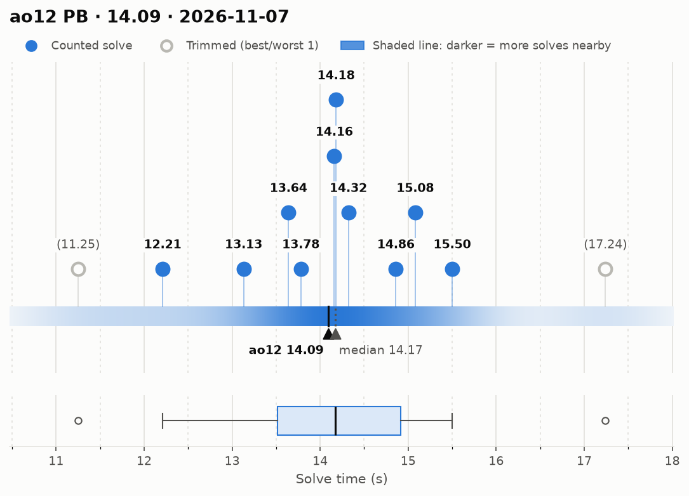
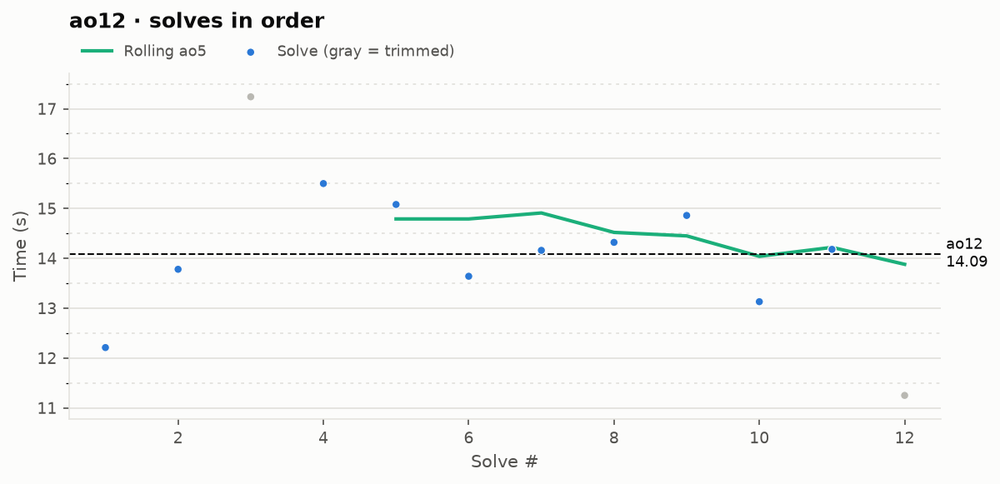

# ao12 PB — 14.09

**Date:** 2026-11-07  
**Previous PB:** 14.16 (2026-09-27) · improved by **0.07s**  
[← all records](../../README.md)

## Stats

| | |
|---|---|
| **ao12 (official, trimmed)** | **14.09** |
| Solves | 12 (trimmed 1 from each end) |
| Mean (all solves) | 14.11 |
| Median | 14.17 |
| Std dev (σ, all solves) | 1.55 |
| Std dev (σ, counted solves only) | 0.97 |
| **Consistency: σ / mean** | **11.0%** |
| Consistency, outlier-proof: IQR / median | 9.9% |
| Min / Best | 11.25 |
| Q1 (25th pct) | 13.51 |
| Q3 (75th pct) | 14.91 |
| Max / Worst | 17.24 |
| IQR (Q3 − Q1) | 1.40 |
| Range | 5.99 |
| Skewness | +0.09 |
| Shapiro–Wilk p (normality) | 0.968 |

**Sub-X counts:** sub-12: 1 · sub-13: 2 · sub-14: 5 · sub-15: 9 · sub-16: 11 · sub-17: 11

Skewness > 0 means a longer tail of slow solves (typical for cubing). Shapiro–Wilk p < 0.05 means the times are unlikely to be normally distributed.

## Distribution

## Solves in order

## Solves

| # | Time | Scramble |
|---|---|---|
| 1 | **12.21** | `R2 B2 L' D2 L D2 R2 D2 F2 L' F2 L B' U' L2 F R2 U L D R2` |
| 2 | **13.78** | `D' B2 L' U F2 U R L2 F2 D2 L2 B D2 L2 F' D2 F2 D L2` |
| 3 | (17.24) | `B2 U2 L2 B2 U B2 U' B2 R2 D L' B R2 D2 L B2 R D' F2` |
| 4 | **15.50** | `U B2 R' D2 L' U2 L B2 D2 R' U2 B2 F L F2 L2 D F L' B R'` |
| 5 | **15.08** | `D2 L2 F L2 U2 F' D2 R2 F2 D2 U' R B2 R B2 L' D' U2 L2 B'` |
| 6 | **13.64** | `L F U' F2 R F2 U B R2 B L2 F' R2 D2 F2 D2 L2 B D' B'` |
| 7 | **14.16** | `R2 F L2 D R2 U2 L2 D' R2 B2 D2 U' R' D' B' R2 B2 D R' U'` |
| 8 | **14.32** | `B D2 F D2 U2 F L2 D2 F' L2 B' L D2 U' F U2 B' U' L B` |
| 9 | **14.86** | `U R2 D2 U2 B D2 B' U2 B L2 B F R' B2 D U B2 U' L2 F` |
| 10 | **13.13** | `U F' B2 D R U D B L' F U' L2 B2 L2 D F2 R2 D' B2 D2 R2` |
| 11 | **14.18** | `D R2 B2 D' U' B2 F2 U' B2 R2 F U2 R U2 B U F L' B D2` |
| 12 | (11.25) | `B L2 U' R2 B2 F2 R U2 L F2 L D2 F2 D B' F2 R F U' F2` |

Bold = counted, (parentheses) = trimmed. `+` = includes a +2 penalty.
