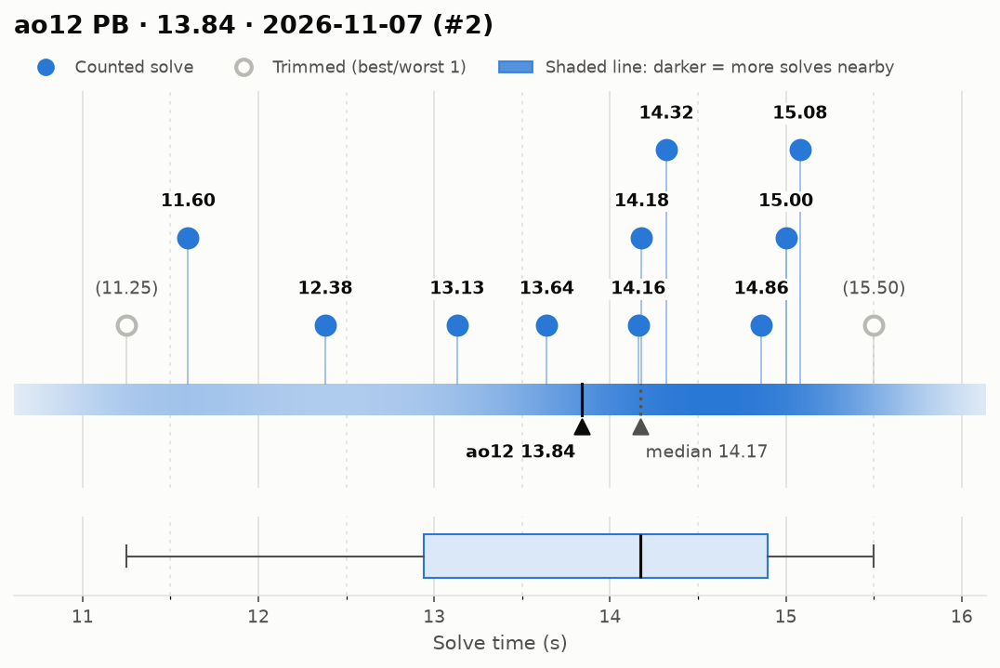
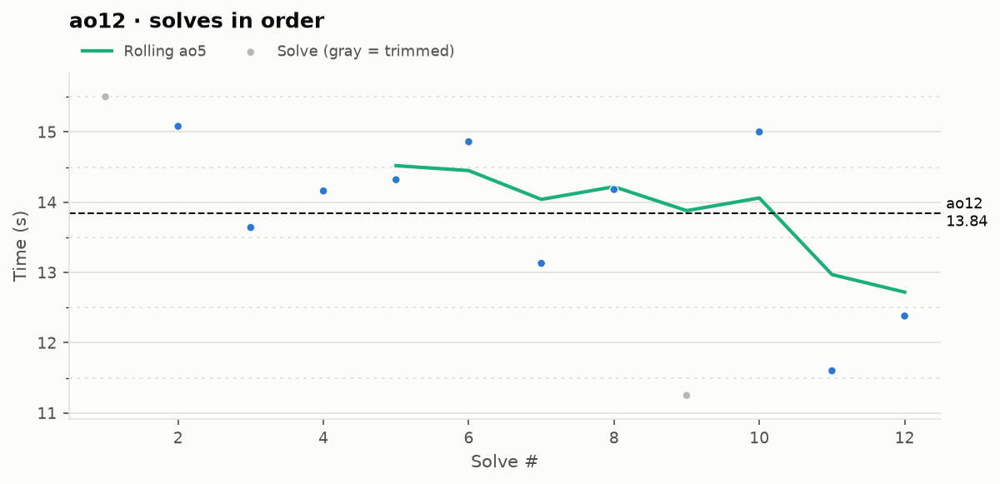

# ao12 PB — 13.84

**Date:** 2026-11-07 (#2)  
**Previous PB:** 14.09 (2026-11-07) · improved by **0.25s**  
[← all records](../../README.md)

## Stats

| | |
|---|---|
| **ao12 (official, trimmed)** | **13.84** |
| Solves | 12 (trimmed 1 from each end) |
| Mean (all solves) | 13.76 |
| Median | 14.17 |
| Std dev (σ, all solves) | 1.40 |
| Std dev (σ, counted solves only) | 1.16 |
| **Consistency: σ / mean** | **10.1%** |
| Consistency, outlier-proof: IQR / median | 13.8% |
| Min / Best | 11.25 |
| Q1 (25th pct) | 12.94 |
| Q3 (75th pct) | 14.89 |
| Max / Worst | 15.50 |
| IQR (Q3 − Q1) | 1.95 |
| Range | 4.25 |
| Skewness | -0.70 |
| Shapiro–Wilk p (normality) | 0.268 |

**Sub-X counts:** sub-12: 2 · sub-13: 3 · sub-14: 5 · sub-15: 9 · sub-16: 12

Skewness > 0 means a longer tail of slow solves (typical for cubing). Shapiro–Wilk p < 0.05 means the times are unlikely to be normally distributed.

## Distribution

## Solves in order

## Solves

| # | Time | Scramble |
|---|---|---|
| 1 | (15.50) | `U B2 R' D2 L' U2 L B2 D2 R' U2 B2 F L F2 L2 D F L' B R'` |
| 2 | **15.08** | `D2 L2 F L2 U2 F' D2 R2 F2 D2 U' R B2 R B2 L' D' U2 L2 B'` |
| 3 | **13.64** | `L F U' F2 R F2 U B R2 B L2 F' R2 D2 F2 D2 L2 B D' B'` |
| 4 | **14.16** | `R2 F L2 D R2 U2 L2 D' R2 B2 D2 U' R' D' B' R2 B2 D R' U'` |
| 5 | **14.32** | `B D2 F D2 U2 F L2 D2 F' L2 B' L D2 U' F U2 B' U' L B` |
| 6 | **14.86** | `U R2 D2 U2 B D2 B' U2 B L2 B F R' B2 D U B2 U' L2 F` |
| 7 | **13.13** | `U F' B2 D R U D B L' F U' L2 B2 L2 D F2 R2 D' B2 D2 R2` |
| 8 | **14.18** | `D R2 B2 D' U' B2 F2 U' B2 R2 F U2 R U2 B U F L' B D2` |
| 9 | (11.25) | `B L2 U' R2 B2 F2 R U2 L F2 L D2 F2 D B' F2 R F U' F2` |
| 10 | **15.00** | `R2 F2 U F2 U B2 L2 D2 F2 D' F2 L' D' F' L R' B R U R F'` |
| 11 | **11.60** | `U2 B' L2 F' U2 B' F2 D2 U2 R2 F' L D' L R' U R' B L2 F'` |
| 12 | **12.38** | `R2 U2 R2 D' B2 U F2 R2 U2 B2 F2 L2 B D U F L D' B2 U2 L` |

Bold = counted, (parentheses) = trimmed. `+` = includes a +2 penalty.
