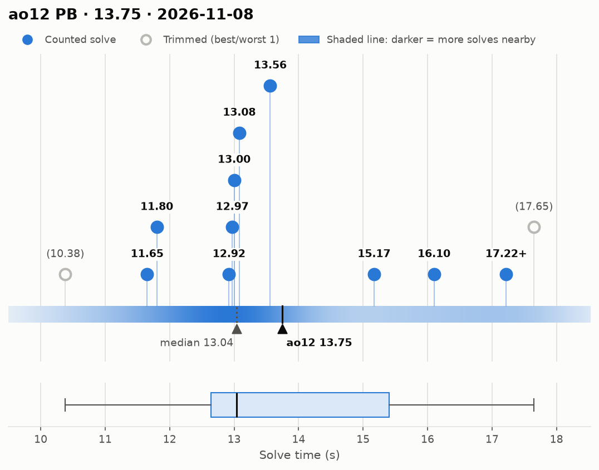
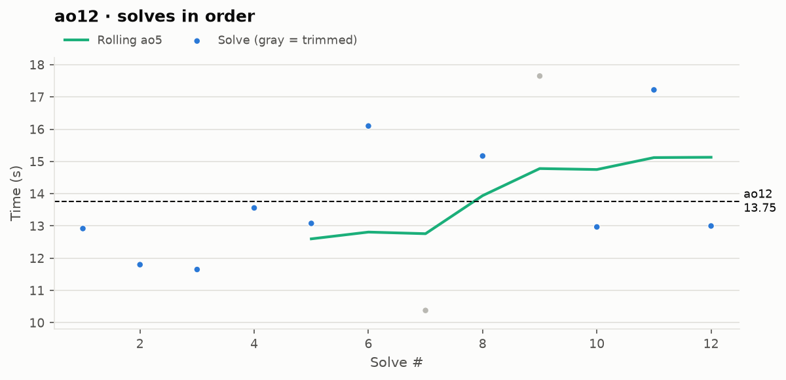

# ao12 PB — 13.75

**Date:** 2026-11-08  
**Previous PB:** 13.84 (2026-11-07 (#2)) · improved by **0.09s**  
[← all records](../../README.md)

## Stats

| | |
|---|---|
| **ao12 (official, trimmed)** | **13.75** |
| Solves | 12 (trimmed 1 from each end) |
| Mean (all solves) | 13.79 |
| Median | 13.04 |
| Std dev (σ, all solves) | 2.27 |
| Std dev (σ, counted solves only) | 1.83 |
| **Consistency: σ / mean** | **16.5%** |
| Consistency, outlier-proof: IQR / median | 21.2% |
| Min / Best | 10.38 |
| Q1 (25th pct) | 12.64 |
| Q3 (75th pct) | 15.40 |
| Max / Worst | 17.65 |
| IQR (Q3 − Q1) | 2.76 |
| Range | 7.27 |
| Skewness | +0.50 |
| Shapiro–Wilk p (normality) | 0.366 |

**Sub-X counts:** sub-11: 1 · sub-12: 3 · sub-13: 5 · sub-14: 8 · sub-15: 8 · sub-16: 9

Skewness > 0 means a longer tail of slow solves (typical for cubing). Shapiro–Wilk p < 0.05 means the times are unlikely to be normally distributed.

## Distribution

## Solves in order

## Solves

| # | Time | Scramble |
|---|---|---|
| 1 | **12.92** | `D2 B U2 L2 B' U2 B' L2 F L2 D2 B U L' U2 L' F' U L B R` |
| 2 | **11.80** | `R2 F2 U2 B D2 B' L2 R2 B' R2 F L R' F2 D' B' U' R D U2` |
| 3 | **11.65** | `B2 D2 F2 D2 R D2 B2 F2 L2 R D2 B' L' D' L R2 D' R F2 L2` |
| 4 | **13.56** | `D' F R2 B2 U2 F2 D' F2 U R2 D2 R2 F' R D2 L' D2 U B2 U'` |
| 5 | **13.08** | `B2 F2 U2 L R B2 L' D2 F2 U2 R' F' D R U2 L F L F2 L2` |
| 6 | **16.10** | `D2 R U2 F2 D L2 D' L2 U2 B2 R2 D' R2 U' B L B2 R2 F' D2 R2` |
| 7 | (10.38) | `L D' R2 B' D2 U2 R2 F D2 L2 U2 B2 L' D' R2 B' L' R2 B2` |
| 8 | **15.17** | `F' L2 F2 R' D2 L' B2 L D2 B2 U2 F2 R' D' B F2 U F' U B U'` |
| 9 | (17.65) | `F2 D2 L2 B2 R D2 L2 U2 R' F2 U2 D B U' B D' U' R U2` |
| 10 | **12.97** | `U2 L' D U2 R2 U2 R2 B' L2 R2 B D2 F D2 R U R F R' D U'` |
| 11 | **17.22+** | `F B2 R2 D2 B2 U' L2 D L2 B2 D' B R' U B2 R U' L B' L2` |
| 12 | **13.00** | `B2 U F2 D2 L2 B2 U B2 D F2 L' D' L' U' F' U B2 L' U2` |

Bold = counted, (parentheses) = trimmed. `+` = includes a +2 penalty.
