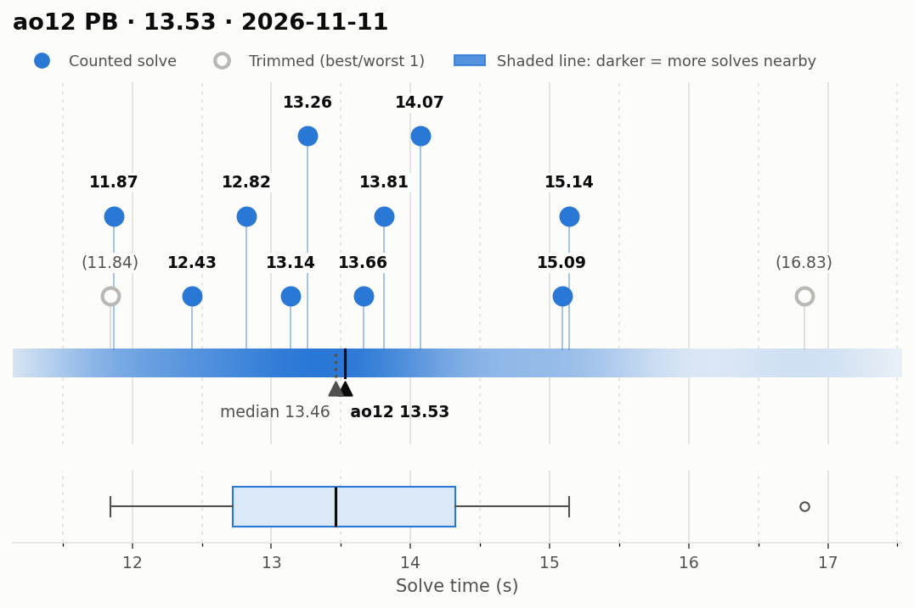
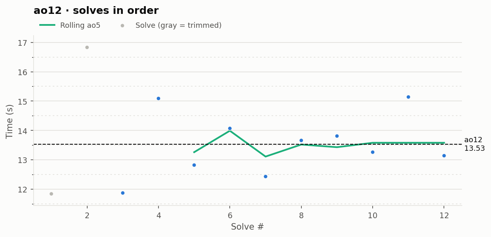

# ao12 PB — 13.53

**Date:** 2026-11-11  
**Previous PB:** 13.75 (2026-11-08) · improved by **0.22s**  
[← all records](../../README.md)

## Stats

| | |
|---|---|
| **ao12 (official, trimmed)** | **13.53** |
| Solves | 12 (trimmed 1 from each end) |
| Mean (all solves) | 13.66 |
| Median | 13.46 |
| Std dev (σ, all solves) | 1.47 |
| Std dev (σ, counted solves only) | 1.06 |
| **Consistency: σ / mean** | **10.7%** |
| Consistency, outlier-proof: IQR / median | 11.9% |
| Min / Best | 11.84 |
| Q1 (25th pct) | 12.72 |
| Q3 (75th pct) | 14.32 |
| Max / Worst | 16.83 |
| IQR (Q3 − Q1) | 1.60 |
| Range | 4.99 |
| Skewness | +0.81 |
| Shapiro–Wilk p (normality) | 0.507 |

**Sub-X counts:** sub-12: 2 · sub-13: 4 · sub-14: 8 · sub-15: 9 · sub-16: 11 · sub-17: 12

Skewness > 0 means a longer tail of slow solves (typical for cubing). Shapiro–Wilk p < 0.05 means the times are unlikely to be normally distributed.

## Distribution

## Solves in order

## Solves

| # | Time | Scramble |
|---|---|---|
| 1 | (11.84) | `B2 U' D2 F' L2 F' D2 L2 B' R2 F L2 F2 L' U2 L' D' B' L D L'` |
| 2 | (16.83) | `B L B' F2 L2 F D2 F U2 L2 D2 L' B R2 U' R2 D' F L2` |
| 3 | **11.87** | `F D2 B' F2 R2 U2 F2 R2 D2 F U2 D R' F L R U' R B' U' R2` |
| 4 | **15.09** | `R2 U' D2 L2 F L2 B U2 L2 B R2 U2 F' U L' R' B' U B D` |
| 5 | **12.82** | `L2 F U2 F R2 U2 B U2 B2 D2 F2 R' D' L R2 D2 U' F' L' U2 F2` |
| 6 | **14.07** | `R U L' F D' F2 B2 U' L R2 U L2 F2 U' R2 L2 U R2 L2 D'` |
| 7 | **12.43** | `D L2 U B2 R2 D2 L2 D F2 U' R2 L F' D B2 L' B2 R F2 L2` |
| 8 | **13.66** | `U2 B D F U2 B U' B' R L F2 D2 L B2 L2 D2 R' F2 L2` |
| 9 | **13.81** | `U2 B2 U D' R F R2 B' F2 R2 B2 U2 L' D2 R D2 B2 D2 F` |
| 10 | **13.26** | `D2 R2 L B' U F' U' L R2 U2 R2 D R2 F2 D' F2 U2 B2 L2 U2 L` |
| 11 | **15.14** | `L2 U L2 R2 B2 U L2 D2 L2 U R U' F' L R2 D R' B D' L2 R'` |
| 12 | **13.14** | `B2 L2 U2 B2 D' U B2 R2 U2 R2 F D2 U' F' D U2 F' L R' B` |

Bold = counted, (parentheses) = trimmed. `+` = includes a +2 penalty.
