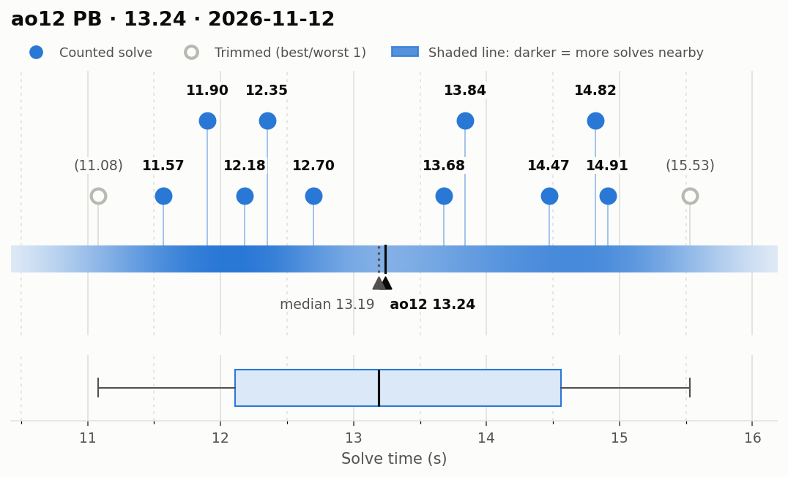
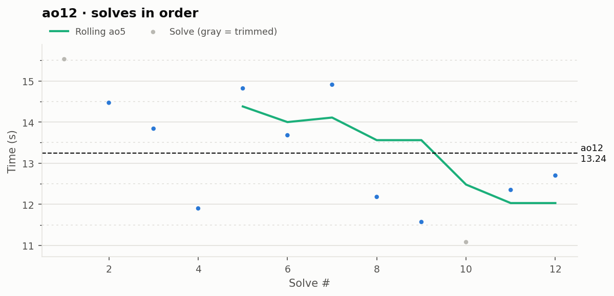

# ao12 PB — 13.24

**Date:** 2026-11-12  
**Previous PB:** 13.53 (2026-11-11) · improved by **0.29s**  
[← all records](../../README.md)

## Stats

| | |
|---|---|
| **ao12 (official, trimmed)** | **13.24** |
| Solves | 12 (trimmed 1 from each end) |
| Mean (all solves) | 13.25 |
| Median | 13.19 |
| Std dev (σ, all solves) | 1.48 |
| Std dev (σ, counted solves only) | 1.25 |
| **Consistency: σ / mean** | **11.2%** |
| Consistency, outlier-proof: IQR / median | 18.6% |
| Min / Best | 11.08 |
| Q1 (25th pct) | 12.11 |
| Q3 (75th pct) | 14.56 |
| Max / Worst | 15.53 |
| IQR (Q3 − Q1) | 2.45 |
| Range | 4.45 |
| Skewness | +0.09 |
| Shapiro–Wilk p (normality) | 0.541 |

**Sub-X counts:** sub-12: 3 · sub-13: 6 · sub-14: 8 · sub-15: 11 · sub-16: 12

Skewness > 0 means a longer tail of slow solves (typical for cubing). Shapiro–Wilk p < 0.05 means the times are unlikely to be normally distributed.

## Distribution

## Solves in order

## Solves

| # | Time | Scramble |
|---|---|---|
| 1 | (15.53) | `L' F D L' B' R U F' D L2 F2 B2 U' R2 D2 F2 R2 U2 B' D2` |
| 2 | **14.47** | `F L' U R2 B2 F2 U' L2 D' U2 R2 U B L' F R2 B2 D B U'` |
| 3 | **13.84** | `U2 R' U2 R2 B L2 B' U2 B D2 B' F D F' R B2 L R` |
| 4 | **11.90** | `D' R2 B2 D2 B2 D2 L2 F2 L' R2 U2 R F2 B' U L2 D' B' D2 L' F2` |
| 5 | **14.82** | `L F2 L2 U2 B R2 B D2 B' U2 L2 B D2 L' U2 B' D2 L' D' F D'` |
| 6 | **13.68** | `B2 R' F' D2 R2 F' L2 R2 B' U2 L2 B R2 U2 R D L2 D' B2 R2 B` |
| 7 | **14.91** | `U2 B R' U F D R' D2 L' U L2 B2 L2 U2 F2 U B2 D' R2 F2` |
| 8 | **12.18** | `R' L U2 B U2 F R L2 U F2 L2 U D R2 F2 D R2 D F2 R'` |
| 9 | **11.57** | `D' U2 F2 L B2 R2 U2 R B2 R B2 D' F' L' B R U' F' U R2` |
| 10 | (11.08) | `L' R2 D2 R2 D' R2 U L2 D' U L2 R U2 B U' B L2 D2 L' R2` |
| 11 | **12.35** | `U2 B2 L U2 L' D2 F2 R2 D2 R D2 L' F D2 U' L' D U2 B F' D'` |
| 12 | **12.70** | `L2 F' D R2 U' L2 R2 D' R2 U F2 U2 L B D L' U2 F R` |

Bold = counted, (parentheses) = trimmed. `+` = includes a +2 penalty.
