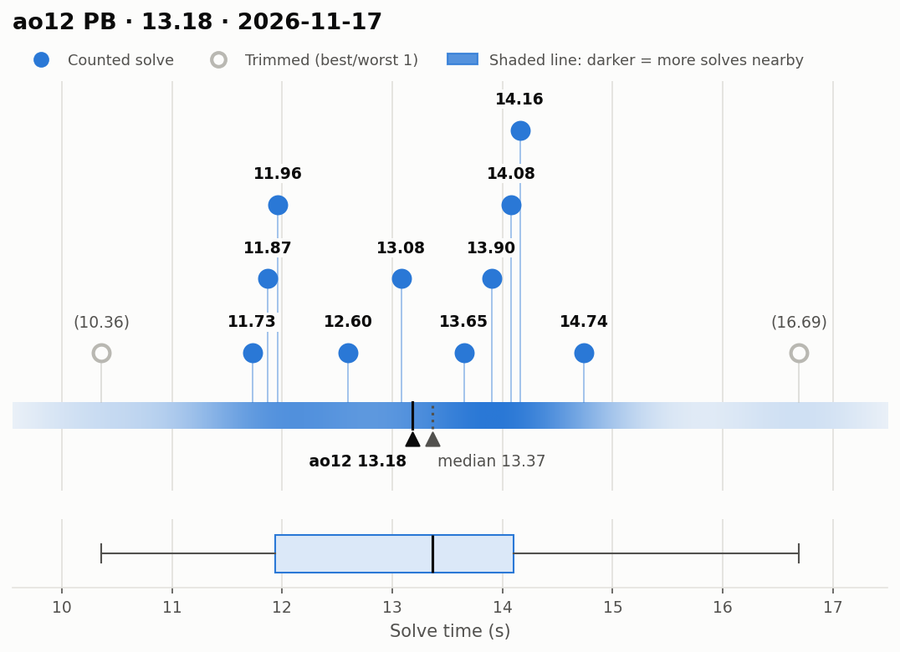
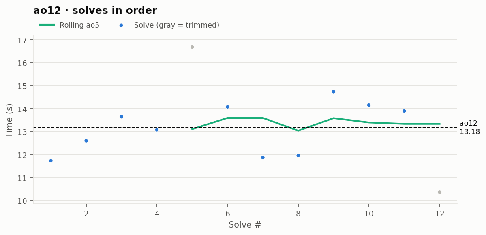

# ao12 PB — 13.18

**Date:** 2026-11-17  
**Previous PB:** 13.24 (2026-11-12) · improved by **0.06s**  
[← all records](../../README.md)

## Stats

| | |
|---|---|
| **ao12 (official, trimmed)** | **13.18** |
| Solves | 12 (trimmed 1 from each end) |
| Mean (all solves) | 13.23 |
| Median | 13.37 |
| Std dev (σ, all solves) | 1.67 |
| Std dev (σ, counted solves only) | 1.09 |
| **Consistency: σ / mean** | **12.6%** |
| Consistency, outlier-proof: IQR / median | 16.2% |
| Min / Best | 10.36 |
| Q1 (25th pct) | 11.94 |
| Q3 (75th pct) | 14.10 |
| Max / Worst | 16.69 |
| IQR (Q3 − Q1) | 2.16 |
| Range | 6.33 |
| Skewness | +0.33 |
| Shapiro–Wilk p (normality) | 0.941 |

**Sub-X counts:** sub-11: 1 · sub-12: 4 · sub-13: 5 · sub-14: 8 · sub-15: 11 · sub-16: 11

Skewness > 0 means a longer tail of slow solves (typical for cubing). Shapiro–Wilk p < 0.05 means the times are unlikely to be normally distributed.

## Distribution

## Solves in order

## Solves

| # | Time | Scramble |
|---|---|---|
| 1 | **11.73** | `U R F' D2 R D R' F R2 D2 B L2 F R2 B' U2 F U2 R'` |
| 2 | **12.60** | `F' U2 L D2 U2 B2 D2 R2 F2 R D2 L F2 D' F' D U R D' F' U'` |
| 3 | **13.65** | `U' R' B U' L F' R' F' D2 B2 U B2 D' F2 U2 B2 U' L2 F2 R` |
| 4 | **13.08** | `D F L2 R2 F R2 B' L2 R2 B L2 R B' L' B L2 R2 U' L F` |
| 5 | (16.69) | `F2 R F2 R2 D R2 B2 U2 F2 D' L2 F2 L2 F' L D F' L B U B` |
| 6 | **14.08** | `B' F2 U' B2 U' R2 U L2 B2 U' F2 R2 B' R F2 L' U' F' D2 L2` |
| 7 | **11.87** | `L D F R2 B2 R2 F' L2 U2 L2 R2 B' L' D2 R2 F D' U L` |
| 8 | **11.96** | `B' L U R2 D' F2 U' B2 U' L2 B2 U2 R2 U B D R F2 D2 R' U'` |
| 9 | **14.74** | `D2 L2 B L B2 D R D' F' D2 R2 D L2 U F2 R2 D F2 D' F2 U'` |
| 10 | **14.16** | `B2 F2 D' L2 D' B2 D F2 U' F2 U2 R B' L2 U' F' L' U2 L2 D U2` |
| 11 | **13.90** | `U2 R' U' B R2 F R' L' B U D' F2 B2 R2 U' R2 B2 D L2 F2 R2` |
| 12 | (10.36) | `B R' B L' U2 R' L2 U' B' L2 U' F2 R2 D2 B2 U' B2 D' L2 D'` |

Bold = counted, (parentheses) = trimmed. `+` = includes a +2 penalty.
