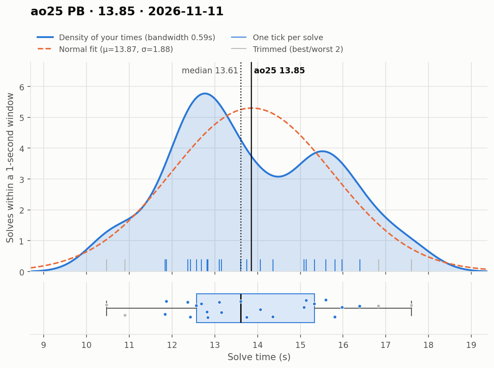
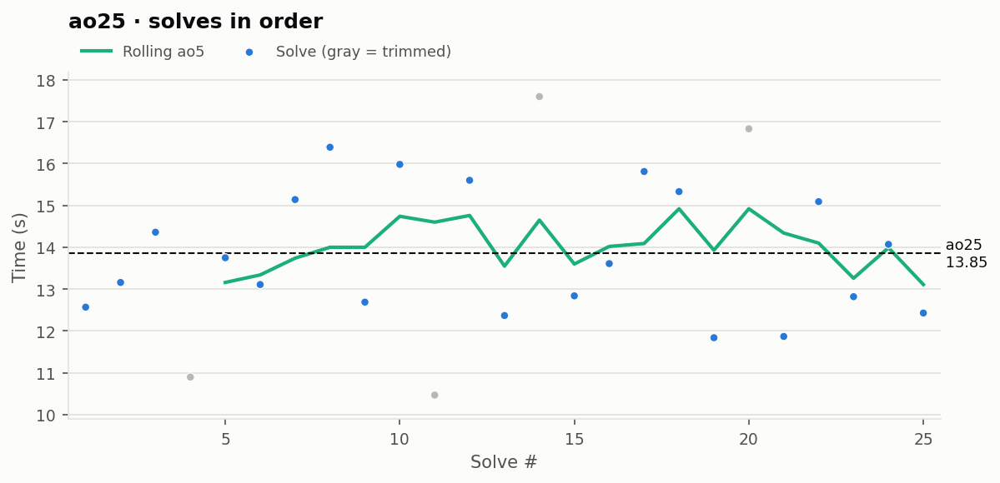

# ao25 PB — 13.85

**Date:** 2026-11-11  
**Previous PB:** 14.31 (2026-09-27) · improved by **0.46s**  
[← all records](../../README.md)

## Stats

| | |
|---|---|
| **ao25 (official, trimmed)** | **13.85** |
| Solves | 25 (trimmed 2 from each end) |
| Mean (all solves) | 13.87 |
| Median | 13.61 |
| Std dev (σ, all solves) | 1.88 |
| Std dev (σ, counted solves only) | 1.45 |
| **Consistency: σ / mean** | **13.6%** |
| Consistency, outlier-proof: IQR / median | 20.3% |
| Min / Best | 10.47 |
| Q1 (25th pct) | 12.57 |
| Q3 (75th pct) | 15.33 |
| Max / Worst | 17.60 |
| IQR (Q3 − Q1) | 2.76 |
| Range | 7.13 |
| Skewness | +0.20 |
| Shapiro–Wilk p (normality) | 0.727 |

**Sub-X counts:** sub-11: 2 · sub-12: 4 · sub-13: 10 · sub-14: 14 · sub-15: 16 · sub-16: 22

Skewness > 0 means a longer tail of slow solves (typical for cubing). Shapiro–Wilk p < 0.05 means the times are unlikely to be normally distributed.

## Distribution

## Solves in order

## Solves

| # | Time | Scramble |
|---|---|---|
| 1 | **12.57** | `F' U2 B2 R' F2 R U2 R B2 U2 L' B2 R U' B' D' F L' F'` |
| 2 | **13.16** | `B' U2 F2 D2 L2 R' B2 U2 R2 D2 R' U2 D L' R' U L F' D2 L` |
| 3 | **14.36** | `D' F2 L2 R2 F2 D' B2 R2 B2 U' R D' L' B2 D B F2 U` |
| 4 | (10.90) | `F' D2 B L2 B R2 F' L2 F L2 U2 L' B2 D R' U2 L' B D R2 U2` |
| 5 | **13.75** | `F R B2 U' F2 L U' D F2 U2 R F2 U2 D2 R' D2 L' B` |
| 6 | **13.11** | `L2 F L U' F' L B' D' L2 U2 F' R2 U2 L2 D2 B' L2 B2 R2` |
| 7 | **15.14** | `R' F U2 F L2 F' L2 F R2 F L2 U2 L U L R' F D' B R2 D'` |
| 8 | **16.39** | `B2 R' B L2 F2 R2 U2 L2 D2 B' R2 B L2 D' B D' L2 B' R B` |
| 9 | **12.69** | `D2 U2 R B2 L2 R2 U2 B2 F2 R2 F' U R B' D2 L' D L' D` |
| 10 | **15.98** | `D' L F D2 B' D2 L2 F L2 D2 F2 R2 F' D2 U' R' F D2 R' D2 L` |
| 11 | (10.47) | `B2 D B2 U R2 U' L2 D F2 U' L2 R' B L R B2 D L2 B U'` |
| 12 | **15.60** | `R2 L' D' B' U F R F2 B2 R2 F2 B2 U2 L2 U' F2 D' R2 D' B' U'` |
| 13 | **12.37** | `U D F' D R' F2 L F2 U2 F2 L2 F D2 R2 U2 F2 R2 L2 F D B2` |
| 14 | (17.60) | `U2 F2 U' F' D L' B D F L D2 R2 B2 U2 F2 R' B2 R' L' F2 B2` |
| 15 | **12.84** | `D F2 L2 D F2 R2 B2 U' F2 D2 R' F' L D R' D2 B L' D2 B` |
| 16 | **13.61** | `F U' L F2 R2 B2 L' U' F' U2 B2 R2 D F2 R2 U B2 L2 B2` |
| 17 | **15.81** | `R2 D' B R L' B' D2 L' D R2 D2 L' B2 R D2 R2 F2 R B2 U2` |
| 18 | **15.33** | `L' B2 R2 B2 R2 D' F2 L2 U' R2 D U' R' B' U B2 D' B U` |
| 19 | **11.84** | `B2 U' D2 F' L2 F' D2 L2 B' R2 F L2 F2 L' U2 L' D' B' L D L'` |
| 20 | (16.83) | `B L B' F2 L2 F D2 F U2 L2 D2 L' B R2 U' R2 D' F L2` |
| 21 | **11.87** | `F D2 B' F2 R2 U2 F2 R2 D2 F U2 D R' F L R U' R B' U' R2` |
| 22 | **15.09** | `R2 U' D2 L2 F L2 B U2 L2 B R2 U2 F' U L' R' B' U B D` |
| 23 | **12.82** | `L2 F U2 F R2 U2 B U2 B2 D2 F2 R' D' L R2 D2 U' F' L' U2 F2` |
| 24 | **14.07** | `R U L' F D' F2 B2 U' L R2 U L2 F2 U' R2 L2 U R2 L2 D'` |
| 25 | **12.43** | `D L2 U B2 R2 D2 L2 D F2 U' R2 L F' D B2 L' B2 R F2 L2` |

Bold = counted, (parentheses) = trimmed. `+` = includes a +2 penalty.
