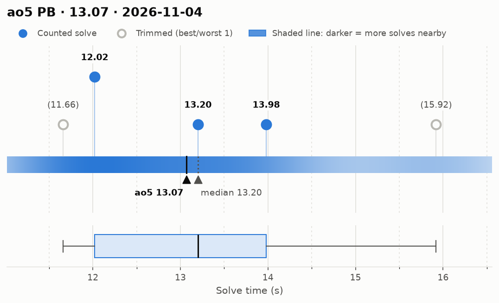
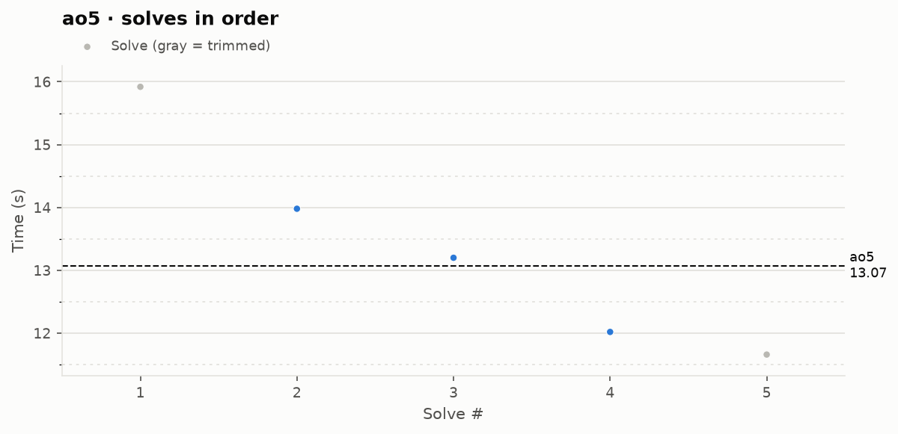

# ao5 PB — 13.07

**Date:** 2026-11-04  
**Previous PB:** 13.16 (2026-09-25 (#2)) · improved by **0.09s**  
[← all records](../../README.md)

## Stats

| | |
|---|---|
| **ao5 (official, trimmed)** | **13.07** |
| Solves | 5 (trimmed 1 from each end) |
| Mean (all solves) | 13.36 |
| Median | 13.20 |
| Std dev (σ, all solves) | 1.71 |
| Std dev (σ, counted solves only) | 0.99 |
| **Consistency: σ / mean** | **12.8%** |
| Consistency, outlier-proof: IQR / median | 14.8% |
| Min / Best | 11.66 |
| Q1 (25th pct) | 12.02 |
| Q3 (75th pct) | 13.98 |
| Max / Worst | 15.92 |
| IQR (Q3 − Q1) | 1.96 |
| Range | 4.26 |

**Sub-X counts:** sub-12: 1 · sub-13: 2 · sub-14: 4 · sub-15: 4 · sub-16: 5

## Distribution

## Solves in order

## Solves

| # | Time | Scramble |
|---|---|---|
| 1 | (15.92) | `F' R2 D B2 U F2 D2 B2 D B2 U2 L F2 R' U' B D B U R` |
| 2 | **13.98** | `D' F' D2 B2 R2 D' F2 U B2 F2 U2 L2 D' F' D' L' R2 U2 B2 F'` |
| 3 | **13.20** | `F D2 L2 F2 U' F2 D' U' L2 U' L' F R F L B' L U L` |
| 4 | **12.02** | `R2 U' R' D2 B2 D' U2 L2 D F2 L2 U' B2 U' F' D R2 B' U' F' L'` |
| 5 | (11.66) | `F U2 F2 D' L2 U' B2 L2 R2 D L2 U2 R B R' B' L' U2 L2 U'` |

Bold = counted, (parentheses) = trimmed. `+` = includes a +2 penalty.
