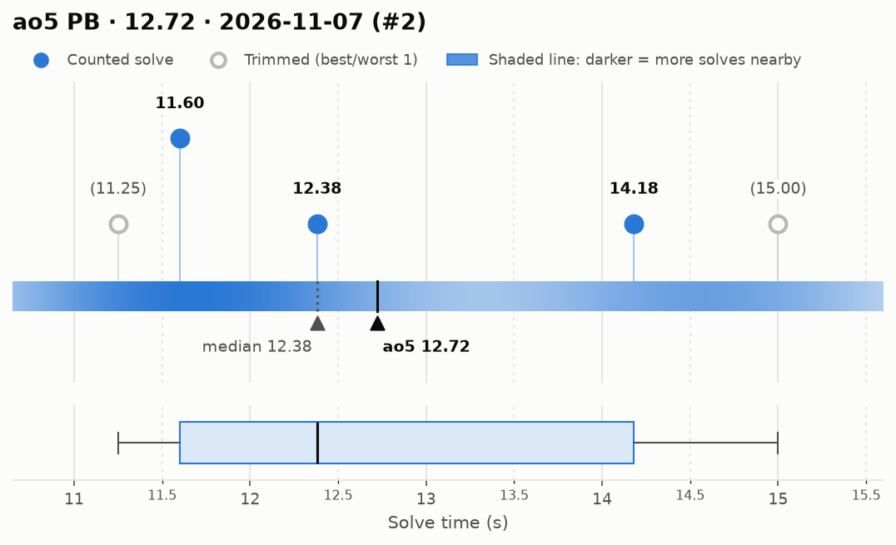
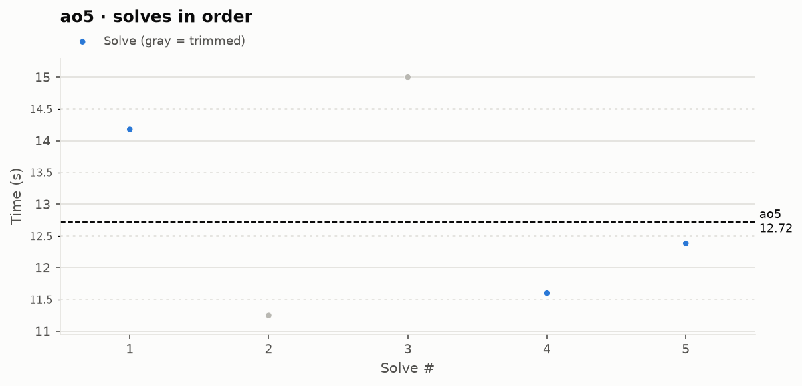

# ao5 PB — 12.72

**Date:** 2026-11-07 (#2)  
**Previous PB:** 12.97 (2026-11-07) · improved by **0.25s**  
[← all records](../../README.md)

## Stats

| | |
|---|---|
| **ao5 (official, trimmed)** | **12.72** |
| Solves | 5 (trimmed 1 from each end) |
| Mean (all solves) | 12.88 |
| Median | 12.38 |
| Std dev (σ, all solves) | 1.64 |
| Std dev (σ, counted solves only) | 1.32 |
| **Consistency: σ / mean** | **12.7%** |
| Consistency, outlier-proof: IQR / median | 20.8% |
| Min / Best | 11.25 |
| Q1 (25th pct) | 11.60 |
| Q3 (75th pct) | 14.18 |
| Max / Worst | 15.00 |
| IQR (Q3 − Q1) | 2.58 |
| Range | 3.75 |

**Sub-X counts:** sub-12: 2 · sub-13: 3 · sub-14: 3 · sub-15: 4 · sub-16: 5

## Distribution

## Solves in order

## Solves

| # | Time | Scramble |
|---|---|---|
| 1 | **14.18** | `D R2 B2 D' U' B2 F2 U' B2 R2 F U2 R U2 B U F L' B D2` |
| 2 | (11.25) | `B L2 U' R2 B2 F2 R U2 L F2 L D2 F2 D B' F2 R F U' F2` |
| 3 | (15.00) | `R2 F2 U F2 U B2 L2 D2 F2 D' F2 L' D' F' L R' B R U R F'` |
| 4 | **11.60** | `U2 B' L2 F' U2 B' F2 D2 U2 R2 F' L D' L R' U R' B L2 F'` |
| 5 | **12.38** | `R2 U2 R2 D' B2 U F2 R2 U2 B2 F2 L2 B D U F L D' B2 U2 L` |

Bold = counted, (parentheses) = trimmed. `+` = includes a +2 penalty.
