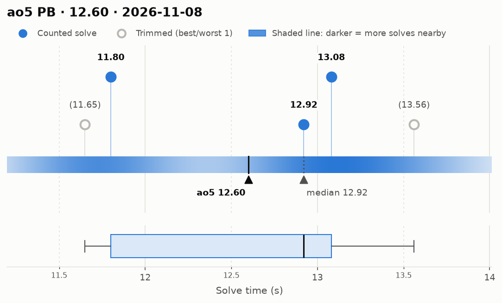
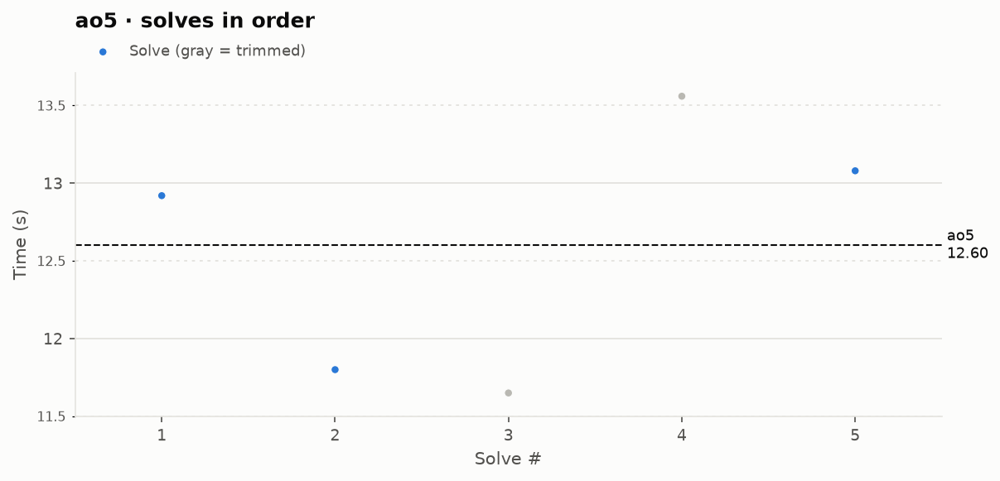

# ao5 PB — 12.60

**Date:** 2026-11-08  
**Previous PB:** 12.72 (2026-11-07 (#2)) · improved by **0.12s**  
[← all records](../../README.md)

## Stats

| | |
|---|---|
| **ao5 (official, trimmed)** | **12.60** |
| Solves | 5 (trimmed 1 from each end) |
| Mean (all solves) | 12.60 |
| Median | 12.92 |
| Std dev (σ, all solves) | 0.84 |
| Std dev (σ, counted solves only) | 0.70 |
| **Consistency: σ / mean** | **6.6%** |
| Consistency, outlier-proof: IQR / median | 9.9% |
| Min / Best | 11.65 |
| Q1 (25th pct) | 11.80 |
| Q3 (75th pct) | 13.08 |
| Max / Worst | 13.56 |
| IQR (Q3 − Q1) | 1.28 |
| Range | 1.91 |

**Sub-X counts:** sub-12: 2 · sub-13: 3 · sub-14: 5

## Distribution

## Solves in order

## Solves

| # | Time | Scramble |
|---|---|---|
| 1 | **12.92** | `D2 B U2 L2 B' U2 B' L2 F L2 D2 B U L' U2 L' F' U L B R` |
| 2 | **11.80** | `R2 F2 U2 B D2 B' L2 R2 B' R2 F L R' F2 D' B' U' R D U2` |
| 3 | (11.65) | `B2 D2 F2 D2 R D2 B2 F2 L2 R D2 B' L' D' L R2 D' R F2 L2` |
| 4 | (13.56) | `D' F R2 B2 U2 F2 D' F2 U R2 D2 R2 F' R D2 L' D2 U B2 U'` |
| 5 | **13.08** | `B2 F2 U2 L R B2 L' D2 F2 U2 R' F' D R U2 L F L F2 L2` |

Bold = counted, (parentheses) = trimmed. `+` = includes a +2 penalty.
