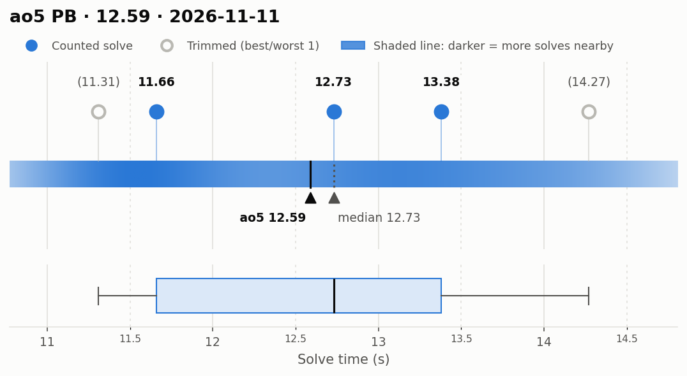
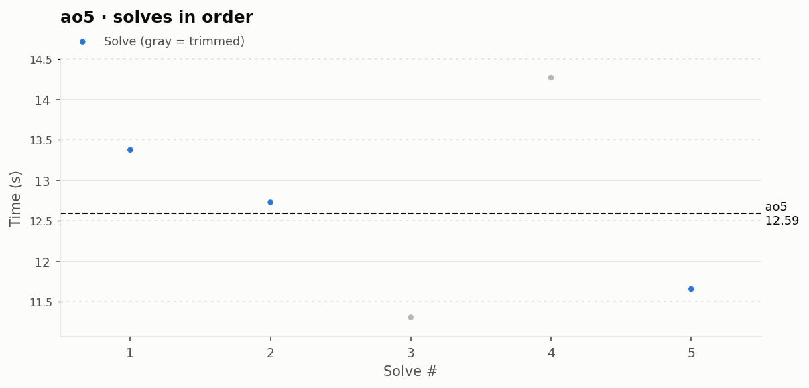

# ao5 PB — 12.59

**Date:** 2026-11-11  
**Previous PB:** 12.60 (2026-11-08) · improved by **0.01s**  
[← all records](../../README.md)

## Stats

| | |
|---|---|
| **ao5 (official, trimmed)** | **12.59** |
| Solves | 5 (trimmed 1 from each end) |
| Mean (all solves) | 12.67 |
| Median | 12.73 |
| Std dev (σ, all solves) | 1.22 |
| Std dev (σ, counted solves only) | 0.87 |
| **Consistency: σ / mean** | **9.6%** |
| Consistency, outlier-proof: IQR / median | 13.5% |
| Min / Best | 11.31 |
| Q1 (25th pct) | 11.66 |
| Q3 (75th pct) | 13.38 |
| Max / Worst | 14.27 |
| IQR (Q3 − Q1) | 1.72 |
| Range | 2.96 |

**Sub-X counts:** sub-12: 2 · sub-13: 3 · sub-14: 4 · sub-15: 5

## Distribution

## Solves in order

## Solves

| # | Time | Scramble |
|---|---|---|
| 1 | **13.38** | `F' U2 R2 B2 D2 F' L2 R2 F2 L2 D' L F2 L' R' D' B' L` |
| 2 | **12.73** | `L F D B U' D F B2 R B' L2 F R2 F' D2 R2 L2 F' U2 F` |
| 3 | (11.31) | `B R2 U' F2 U L2 U2 B2 R2 F2 L' D2 B U2 L2 B U B'` |
| 4 | (14.27) | `R2 U F2 U B2 D2 R2 D' B2 D' L2 B R' F' D2 L F2 D R2 F2 R` |
| 5 | **11.66** | `U' F' R2 D2 L U2 L D2 L' D2 F2 L F2 U L' F L' D2 U B' D'` |

Bold = counted, (parentheses) = trimmed. `+` = includes a +2 penalty.
