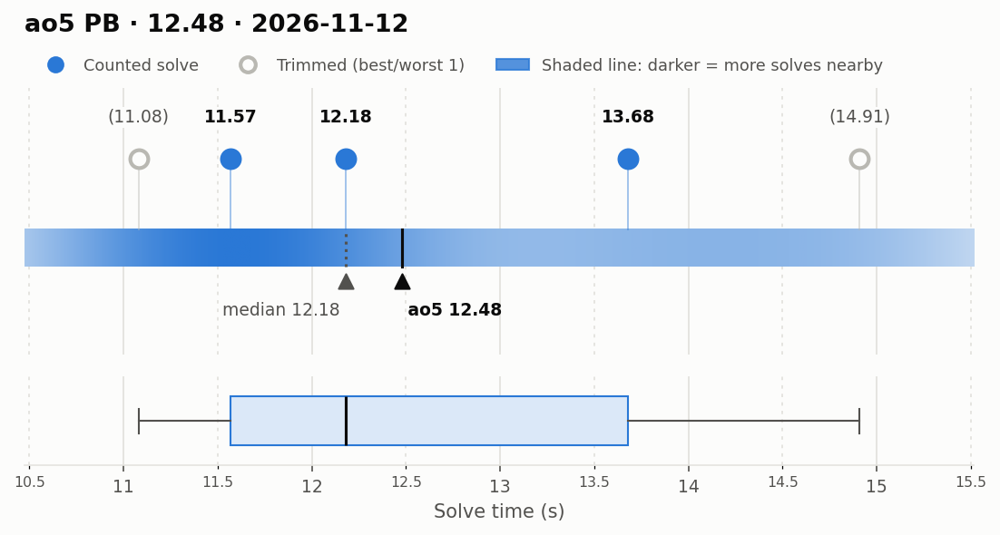
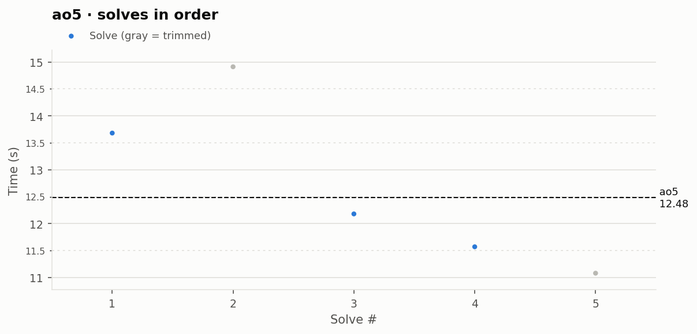

# ao5 PB — 12.48

**Date:** 2026-11-12  
**Previous PB:** 12.59 (2026-11-11) · improved by **0.11s**  
[← all records](../../README.md)

## Stats

| | |
|---|---|
| **ao5 (official, trimmed)** | **12.48** |
| Solves | 5 (trimmed 1 from each end) |
| Mean (all solves) | 12.68 |
| Median | 12.18 |
| Std dev (σ, all solves) | 1.58 |
| Std dev (σ, counted solves only) | 1.09 |
| **Consistency: σ / mean** | **12.5%** |
| Consistency, outlier-proof: IQR / median | 17.3% |
| Min / Best | 11.08 |
| Q1 (25th pct) | 11.57 |
| Q3 (75th pct) | 13.68 |
| Max / Worst | 14.91 |
| IQR (Q3 − Q1) | 2.11 |
| Range | 3.83 |

**Sub-X counts:** sub-12: 2 · sub-13: 3 · sub-14: 4 · sub-15: 5

## Distribution

## Solves in order

## Solves

| # | Time | Scramble |
|---|---|---|
| 1 | **13.68** | `B2 R' F' D2 R2 F' L2 R2 B' U2 L2 B R2 U2 R D L2 D' B2 R2 B` |
| 2 | (14.91) | `U2 B R' U F D R' D2 L' U L2 B2 L2 U2 F2 U B2 D' R2 F2` |
| 3 | **12.18** | `R' L U2 B U2 F R L2 U F2 L2 U D R2 F2 D R2 D F2 R'` |
| 4 | **11.57** | `D' U2 F2 L B2 R2 U2 R B2 R B2 D' F' L' B R U' F' U R2` |
| 5 | (11.08) | `L' R2 D2 R2 D' R2 U L2 D' U L2 R U2 B U' B L2 D2 L' R2` |

Bold = counted, (parentheses) = trimmed. `+` = includes a +2 penalty.
