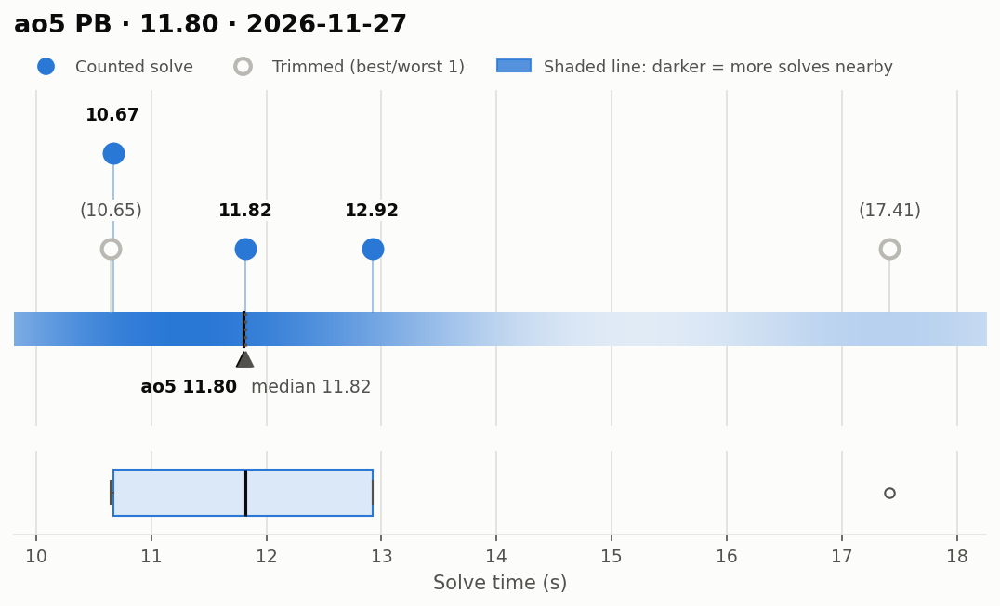
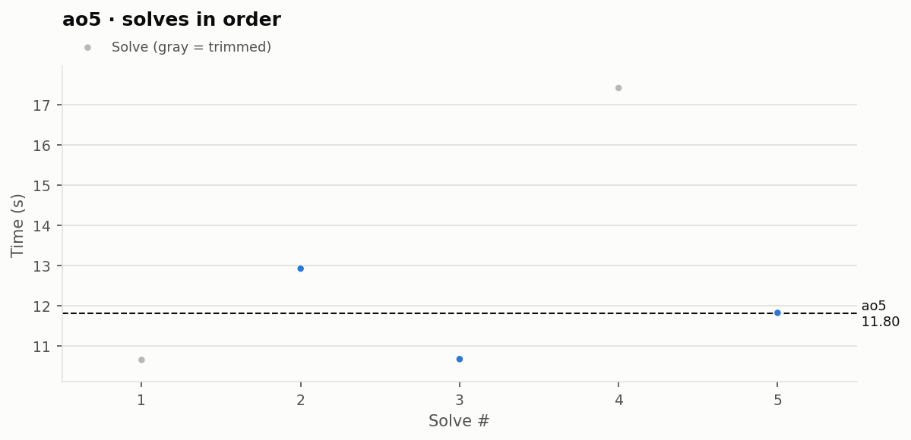

# ao5 PB — 11.80

**Date:** 2026-11-27  
**Previous PB:** 12.03 (2026-11-12 (#2)) · improved by **0.23s**  
[← all records](../../README.md)

## Stats

| | |
|---|---|
| **ao5 (official, trimmed)** | **11.80** |
| Solves | 5 (trimmed 1 from each end) |
| Mean (all solves) | 12.69 |
| Median | 11.82 |
| Std dev (σ, all solves) | 2.80 |
| Std dev (σ, counted solves only) | 1.13 |
| **Consistency: σ / mean** | **22.0%** |
| Consistency, outlier-proof: IQR / median | 19.0% |
| Min / Best | 10.65 |
| Q1 (25th pct) | 10.67 |
| Q3 (75th pct) | 12.92 |
| Max / Worst | 17.41 |
| IQR (Q3 − Q1) | 2.25 |
| Range | 6.76 |

**Sub-X counts:** sub-11: 2 · sub-12: 3 · sub-13: 4 · sub-14: 4 · sub-15: 4 · sub-16: 4

## Distribution

## Solves in order

## Solves

| # | Time | Scramble |
|---|---|---|
| 1 | (10.65) | `B2 L2 R2 F U2 B' R2 F' D2 R2 B' L B F' R F2 U' L2 D L R` |
| 2 | **12.92** | `R' D L2 B2 L2 F2 R2 D U2 R2 D' B U2 L2 R F2 U' B U' L` |
| 3 | **10.67** | `U D' F2 R2 L2 B' R2 U R' L2 B2 D R2 U' L2 U L2 D' R2 B2` |
| 4 | (17.41) | `R F2 U' R2 F2 L2 B D2 B' U2 R2 F' D2 R2 D' F D2 B L F' R'` |
| 5 | **11.82** | `L2 D R2 U2 L2 R2 F2 U' F2 U' F U' B2 L U R2 D U B2` |

Bold = counted, (parentheses) = trimmed. `+` = includes a +2 penalty.
