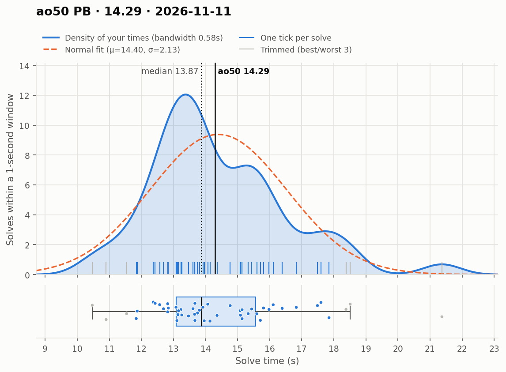
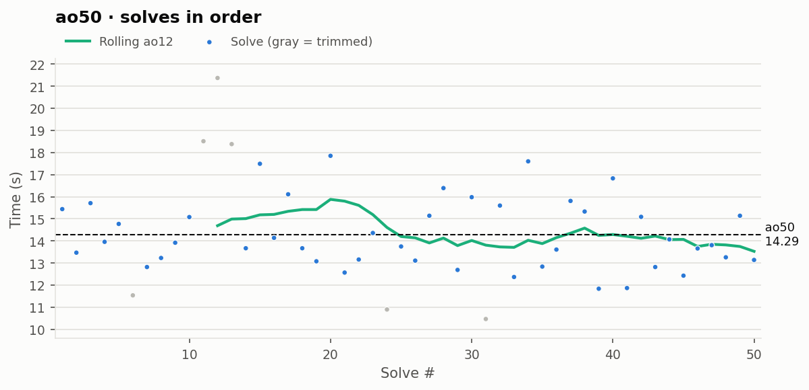

# ao50 PB — 14.29

**Date:** 2026-11-11  
**Previous PB:** 14.72 (2026-09-27) · improved by **0.43s**  
[← all records](../../README.md)

## Stats

| | |
|---|---|
| **ao50 (official, trimmed)** | **14.29** |
| Solves | 50 (trimmed 3 from each end) |
| Mean (all solves) | 14.40 |
| Median | 13.87 |
| Std dev (σ, all solves) | 2.13 |
| Std dev (σ, counted solves only) | 1.56 |
| **Consistency: σ / mean** | **14.8%** |
| Consistency, outlier-proof: IQR / median | 17.8% |
| Min / Best | 10.47 |
| Q1 (25th pct) | 13.09 |
| Q3 (75th pct) | 15.56 |
| Max / Worst | 21.37 |
| IQR (Q3 − Q1) | 2.47 |
| Range | 10.90 |
| Skewness | +0.89 |
| Shapiro–Wilk p (normality) | 0.040 |

**Sub-X counts:** sub-11: 2 · sub-12: 5 · sub-13: 12 · sub-14: 27 · sub-15: 31 · sub-16: 41

Skewness > 0 means a longer tail of slow solves (typical for cubing). Shapiro–Wilk p < 0.05 means the times are unlikely to be normally distributed.

## Distribution

## Solves in order

## Solves

| # | Time | Scramble |
|---|---|---|
| 1 | **15.44** | `R2 B L2 B' L2 B2 L2 B' L2 F U' L' D' U F' L' R2 D2 U B2` |
| 2 | **13.47** | `L2 D2 B2 D' F2 R2 D' R2 F2 D' R2 B2 F R' F2 R' D R' D B' L` |
| 3 | **15.71** | `D B U' L D' F L' U D2 B2 L' D2 L' B2 R2 L' D2 F2 D2 L` |
| 4 | **13.96** | `B' L' U2 L2 U' R2 B2 U R2 D2 L2 B2 D' B2 R' U F D2 F D` |
| 5 | **14.77** | `L B2 U' L2 D F U B R' D2 R D2 L2 B2 U2 R B2 L' B'` |
| 6 | (11.54) | `F2 R2 D U B2 R2 U2 R2 D L' F2 D' R F L' B U2 L2 F` |
| 7 | **12.82** | `R D U2 B R2 B L2 D2 R2 F' D2 F U L U' L2 F2 L2 U2` |
| 8 | **13.23** | `L2 D2 B2 U R2 F2 U2 B2 R2 U2 B L' R' B D' R2 F' D' B L' R2` |
| 9 | **13.92** | `B2 U' F2 D R2 F2 U' R2 D' R2 B2 D2 R B2 R D2 U B U' R` |
| 10 | **15.08** | `B' L' D L2 D L U' F' U2 R2 U2 L' F2 B2 L2 U2 R' U2 B'` |
| 11 | (18.51) | `F L2 D2 R F' D' B U2 R' B2 L F2 B2 L' F2 D2 R2 U2 F` |
| 12 | (21.37) | `F2 L' R2 B2 U2 F2 U2 L' F2 L2 U2 D' B L' R U2 L' F U F'` |
| 13 | (18.38) | `L2 F2 R B2 L' B2 F2 D2 F2 R F2 R' D' L2 B F U' R2 F' L' D'` |
| 14 | **13.67** | `D R B U2 R U2 B2 U2 F2 U2 R' B2 L R2 F' R2 D U' L D R'` |
| 15 | **17.49** | `F U2 R2 D B' U2 B' L' F2 U L2 D2 R2 L2 U F2 U B2 D L2 R'` |
| 16 | **14.14** | `U' F2 U F2 R2 B2 R2 D B2 U' B D2 R' D L D U R' B2 U` |
| 17 | **16.11** | `R2 U R2 L' U2 D L2 U F' R F2 L' U2 F2 U2 R U2 R' B2 R2 B2` |
| 18 | **13.67** | `F B' R' L D L B' D L2 F' U2 L2 F2 R2 L2 U' R2 D B2 L2 D` |
| 19 | **13.08** | `F' L2 U2 B R2 U2 L2 U2 B' F2 D2 F2 R' D R2 F' D2 U2 L R2` |
| 20 | **17.85** | `U' B2 R2 B2 D2 L2 B' R D L R F L' D' B2 F` |
| 21 | **12.57** | `F' U2 B2 R' F2 R U2 R B2 U2 L' B2 R U' B' D' F L' F'` |
| 22 | **13.16** | `B' U2 F2 D2 L2 R' B2 U2 R2 D2 R' U2 D L' R' U L F' D2 L` |
| 23 | **14.36** | `D' F2 L2 R2 F2 D' B2 R2 B2 U' R D' L' B2 D B F2 U` |
| 24 | (10.90) | `F' D2 B L2 B R2 F' L2 F L2 U2 L' B2 D R' U2 L' B D R2 U2` |
| 25 | **13.75** | `F R B2 U' F2 L U' D F2 U2 R F2 U2 D2 R' D2 L' B` |
| 26 | **13.11** | `L2 F L U' F' L B' D' L2 U2 F' R2 U2 L2 D2 B' L2 B2 R2` |
| 27 | **15.14** | `R' F U2 F L2 F' L2 F R2 F L2 U2 L U L R' F D' B R2 D'` |
| 28 | **16.39** | `B2 R' B L2 F2 R2 U2 L2 D2 B' R2 B L2 D' B D' L2 B' R B` |
| 29 | **12.69** | `D2 U2 R B2 L2 R2 U2 B2 F2 R2 F' U R B' D2 L' D L' D` |
| 30 | **15.98** | `D' L F D2 B' D2 L2 F L2 D2 F2 R2 F' D2 U' R' F D2 R' D2 L` |
| 31 | (10.47) | `B2 D B2 U R2 U' L2 D F2 U' L2 R' B L R B2 D L2 B U'` |
| 32 | **15.60** | `R2 L' D' B' U F R F2 B2 R2 F2 B2 U2 L2 U' F2 D' R2 D' B' U'` |
| 33 | **12.37** | `U D F' D R' F2 L F2 U2 F2 L2 F D2 R2 U2 F2 R2 L2 F D B2` |
| 34 | **17.60** | `U2 F2 U' F' D L' B D F L D2 R2 B2 U2 F2 R' B2 R' L' F2 B2` |
| 35 | **12.84** | `D F2 L2 D F2 R2 B2 U' F2 D2 R' F' L D R' D2 B L' D2 B` |
| 36 | **13.61** | `F U' L F2 R2 B2 L' U' F' U2 B2 R2 D F2 R2 U B2 L2 B2` |
| 37 | **15.81** | `R2 D' B R L' B' D2 L' D R2 D2 L' B2 R D2 R2 F2 R B2 U2` |
| 38 | **15.33** | `L' B2 R2 B2 R2 D' F2 L2 U' R2 D U' R' B' U B2 D' B U` |
| 39 | **11.84** | `B2 U' D2 F' L2 F' D2 L2 B' R2 F L2 F2 L' U2 L' D' B' L D L'` |
| 40 | **16.83** | `B L B' F2 L2 F D2 F U2 L2 D2 L' B R2 U' R2 D' F L2` |
| 41 | **11.87** | `F D2 B' F2 R2 U2 F2 R2 D2 F U2 D R' F L R U' R B' U' R2` |
| 42 | **15.09** | `R2 U' D2 L2 F L2 B U2 L2 B R2 U2 F' U L' R' B' U B D` |
| 43 | **12.82** | `L2 F U2 F R2 U2 B U2 B2 D2 F2 R' D' L R2 D2 U' F' L' U2 F2` |
| 44 | **14.07** | `R U L' F D' F2 B2 U' L R2 U L2 F2 U' R2 L2 U R2 L2 D'` |
| 45 | **12.43** | `D L2 U B2 R2 D2 L2 D F2 U' R2 L F' D B2 L' B2 R F2 L2` |
| 46 | **13.66** | `U2 B D F U2 B U' B' R L F2 D2 L B2 L2 D2 R' F2 L2` |
| 47 | **13.81** | `U2 B2 U D' R F R2 B' F2 R2 B2 U2 L' D2 R D2 B2 D2 F` |
| 48 | **13.26** | `D2 R2 L B' U F' U' L R2 U2 R2 D R2 F2 D' F2 U2 B2 L2 U2 L` |
| 49 | **15.14** | `L2 U L2 R2 B2 U L2 D2 L2 U R U' F' L R2 D R' B D' L2 R'` |
| 50 | **13.14** | `B2 L2 U2 B2 D' U B2 R2 U2 R2 F D2 U' F' D U2 F' L R' B` |

Bold = counted, (parentheses) = trimmed. `+` = includes a +2 penalty.
