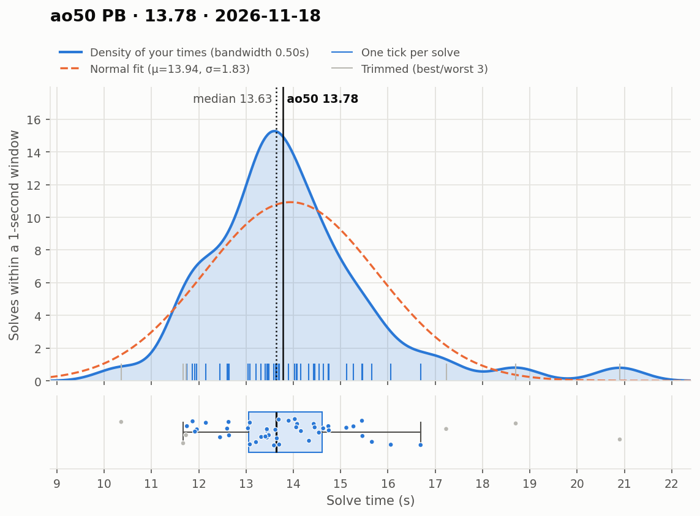
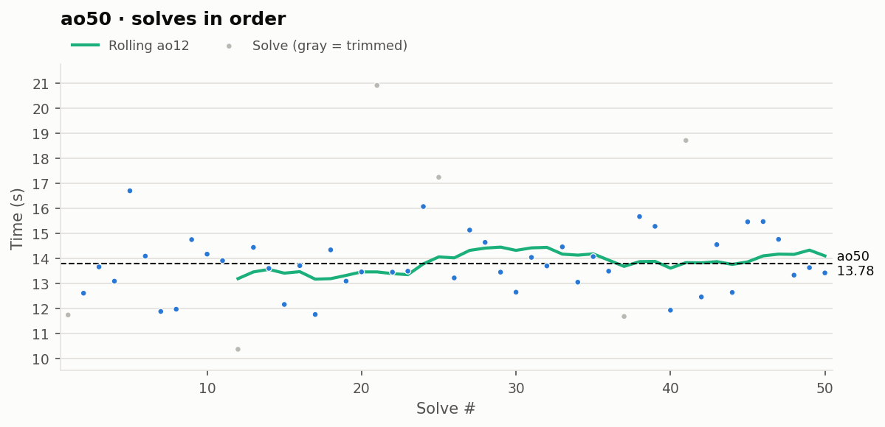

# ao50 PB — 13.78

**Date:** 2026-11-18  
**Previous PB:** 14.29 (2026-11-11) · improved by **0.51s**  
[← all records](../../README.md)

## Stats

| | |
|---|---|
| **ao50 (official, trimmed)** | **13.78** |
| Solves | 50 (trimmed 3 from each end) |
| Mean (all solves) | 13.94 |
| Median | 13.63 |
| Std dev (σ, all solves) | 1.83 |
| Std dev (σ, counted solves only) | 1.15 |
| **Consistency: σ / mean** | **13.1%** |
| Consistency, outlier-proof: IQR / median | 11.4% |
| Min / Best | 10.36 |
| Q1 (25th pct) | 13.05 |
| Q3 (75th pct) | 14.61 |
| Max / Worst | 20.90 |
| IQR (Q3 − Q1) | 1.56 |
| Range | 10.54 |
| Skewness | +1.42 |
| Shapiro–Wilk p (normality) | 0.001 |

**Sub-X counts:** sub-11: 1 · sub-12: 7 · sub-13: 12 · sub-14: 29 · sub-15: 40 · sub-16: 45

Skewness > 0 means a longer tail of slow solves (typical for cubing). Shapiro–Wilk p < 0.05 means the times are unlikely to be normally distributed.

## Distribution

## Solves in order

## Solves

| # | Time | Scramble |
|---|---|---|
| 1 | (11.73) | `U R F' D2 R D R' F R2 D2 B L2 F R2 B' U2 F U2 R'` |
| 2 | **12.60** | `F' U2 L D2 U2 B2 D2 R2 F2 R D2 L F2 D' F' D U R D' F' U'` |
| 3 | **13.65** | `U' R' B U' L F' R' F' D2 B2 U B2 D' F2 U2 B2 U' L2 F2 R` |
| 4 | **13.08** | `D F L2 R2 F R2 B' L2 R2 B L2 R B' L' B L2 R2 U' L F` |
| 5 | **16.69** | `F2 R F2 R2 D R2 B2 U2 F2 D' L2 F2 L2 F' L D F' L B U B` |
| 6 | **14.08** | `B' F2 U' B2 U' R2 U L2 B2 U' F2 R2 B' R F2 L' U' F' D2 L2` |
| 7 | **11.87** | `L D F R2 B2 R2 F' L2 U2 L2 R2 B' L' D2 R2 F D' U L` |
| 8 | **11.96** | `B' L U R2 D' F2 U' B2 U' L2 B2 U2 R2 U B D R F2 D2 R' U'` |
| 9 | **14.74** | `D2 L2 B L B2 D R D' F' D2 R2 D L2 U F2 R2 D F2 D' F2 U'` |
| 10 | **14.16** | `B2 F2 D' L2 D' B2 D F2 U' F2 U2 R B' L2 U' F' L' U2 L2 D U2` |
| 11 | **13.90** | `U2 R' U' B R2 F R' L' B U D' F2 B2 R2 U' R2 B2 D L2 F2 R2` |
| 12 | (10.36) | `B R' B L' U2 R' L2 U' B' L2 U' F2 R2 D2 B2 U' B2 D' L2 D'` |
| 13 | **14.43** | `L F U2 F D' F R' B' U' L' D2 B D2 L2 D2 L2 B D2 B' U2` |
| 14 | **13.59** | `D' R2 D2 B2 R2 U' L2 D U2 B' R U2 F2 D' U2 L B' R` |
| 15 | **12.15** | `F D L B2 R' B2 D' F' D2 B2 U2 F' L2 B2 U2 R2 D2 F' D2 U L` |
| 16 | **13.70** | `U2 L2 U L2 B2 D' B2 L2 B2 U' B' L' F' D2 L2 F' U L' F` |
| 17 | **11.75** | `R' D F' U2 B' L U F2 R2 D2 F2 U2 L F2 R2 B2 U2 L D2 F D2` |
| 18 | **14.33** | `L2 F R2 D F2 U' F2 U' R2 U B2 D R2 D' L' D U2 F2 D B F2` |
| 19 | **13.08** | `U2 R U' B' D2 B' D2 F' L2 D2 L2 U2 F' R2 D' R B2 D' L U2 B` |
| 20 | **13.45** | `R B2 U2 B R D' F' R2 L2 U B2 U2 L2 U2 R2 F2 U' F2 L' B` |
| 21 | (20.90) | `F2 D2 F2 R2 U' F' R F' L U F' B' L2 F L2 U2 B R2 F' U2` |
| 22 | **13.44** | `L D L2 F2 U' F2 U' B2 D2 L2 F2 U' L F L2 D2 U' F2 L2` |
| 23 | **13.48** | `D2 R2 U L2 B2 U2 B2 D R2 D2 U' B U2 L U2 L2 B F' D U' R'` |
| 24 | **16.06** | `B' U2 F2 U L2 U' F2 U2 R2 U R2 L' D F R' F' L F L F` |
| 25 | (17.23) | `L B D2 F2 L2 U2 R2 U2 B D2 F D F L2 R' F' R2 B` |
| 26 | **13.21** | `F' B' U D R' U' F D2 F2 D2 F2 L D2 R D2 R' F2 D2 L' B'` |
| 27 | **15.12** | `L2 D' B' U' B2 U2 L' U F' R' L' F2 U2 D2 L F2 D2 R' U2 R'` |
| 28 | **14.63+** | `R U2 R U' R D F2 B R' U2 D2 F U2 B L2 F D2 B2 U2 F2 L2` |
| 29 | **13.44** | `R' F R B' D' R L' U' B L2 F' D2 B' U2 F2 U2 F U2 B D' F2` |
| 30 | **12.64** | `U' R' U' L' U2 L' F' D' B2 L2 D2 R2 B L2 F' L2 U2 D2 F R B` |
| 31 | **14.03** | `F' D2 U2 F' D2 B U2 R2 B2 F' D R U' L2 B' D L U B' F` |
| 32 | **13.69** | `D F B2 D F2 D L2 U' B2 F2 D' U2 B L F2 U' R B' L2 B` |
| 33 | **14.45** | `F' B2 L2 F2 D' R2 D' F2 L2 F2 L2 D B' U2 L F' L' D2 B D'` |
| 34 | **13.04** | `B L B2 L F2 R B2 R D2 F2 D2 R' B' D' L' B' F2 L' F2 U'` |
| 35 | **14.06** | `L2 B2 L2 R2 D' R2 D' F2 D R2 F2 B L D' F' D' L R' D2 U' F'` |
| 36 | **13.48** | `U' F' B' U R' B D B' L U R2 F2 D B2 U R2 D F2 B2 D' R2` |
| 37 | (11.67) | `L D2 R' B L2 D2 L' B2 D' R2 U' R2 D2 R2 B2 U2 D R' U2` |
| 38 | **15.66** | `R2 U B2 U' L2 U R2 U R2 F2 B' R' U2 F' D U2 L F2 L2 R'` |
| 39 | **15.27** | `F D' B' L2 F2 R' D2 U2 R B2 U2 L B2 D' F' D2 R' F2 L U'` |
| 40 | **11.92** | `U F' D' L' F' U B R2 D R U2 R B2 U2 L F2 U2 R2 F2 U2 L` |
| 41 | (18.70) | `D L B2 D' F2 D F U2 B2 D2 R' F2 L F2 U2 R' F2 B2 D' R'` |
| 42 | **12.45** | `L B2 R2 U' F2 L2 D B2 L2 F2 D R' D R2 F' R2 B' R D' B'` |
| 43 | **14.54** | `L2 U B2 U' R2 B2 U' R2 B2 U' R2 B L' D F' R' B' U R2 U'` |
| 44 | **12.63** | `B' R U F' L2 D2 U2 F' U2 L2 B R2 U2 L U' R B F2 U L'` |
| 45 | **15.45** | `D2 R2 F R2 F2 D2 B R2 F R2 F2 U2 L R2 U2 F' R2 D L' U' R2` |
| 46 | **15.46** | `R B L D' R' F R' L2 D R2 L2 F2 D R2 U' R2 D F2 R2 B R'` |
| 47 | **14.75** | `B' F2 L F2 U2 F2 U2 L F2 L' D2 B2 R D' B R B' U' F U2 R'` |
| 48 | **13.32** | `U2 L' F2 R U' L2 B' F2 U2 R2 U' F2 B2 L2 D2 F2 D' B2 R'` |
| 49 | **13.62** | `F2 U2 F2 U R2 U R2 U' L2 D' L2 U2 F' L' D' U2 L' R2 D2` |
| 50 | **13.41** | `U2 R2 U2 R2 D' B2 D R2 F2 L2 D L' F U' L2 B D B F' U'` |

Bold = counted, (parentheses) = trimmed. `+` = includes a +2 penalty.
